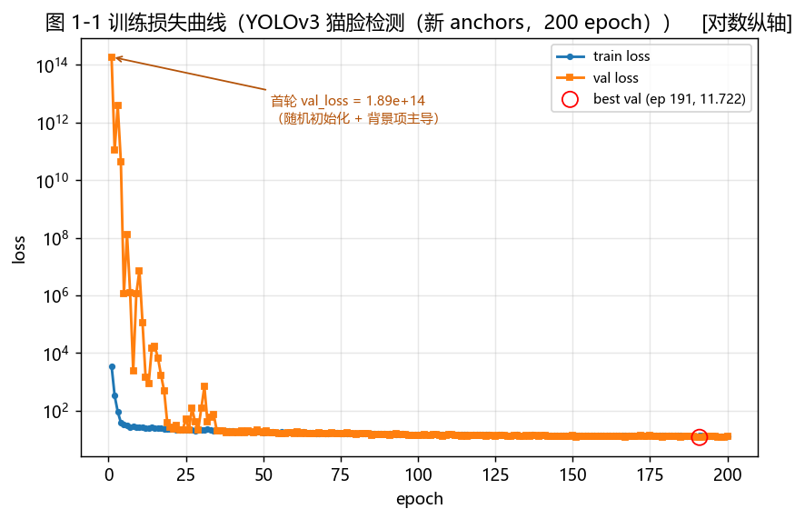
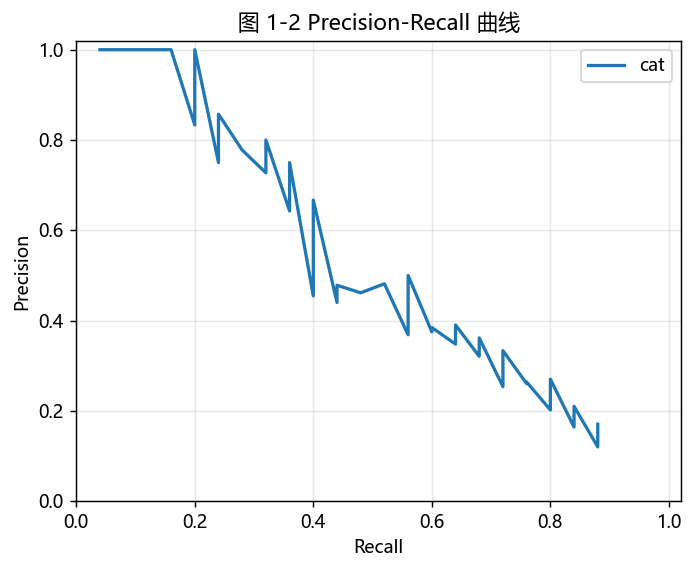
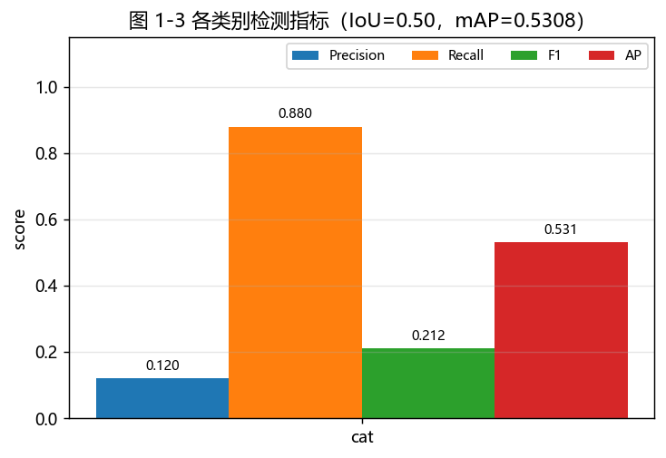
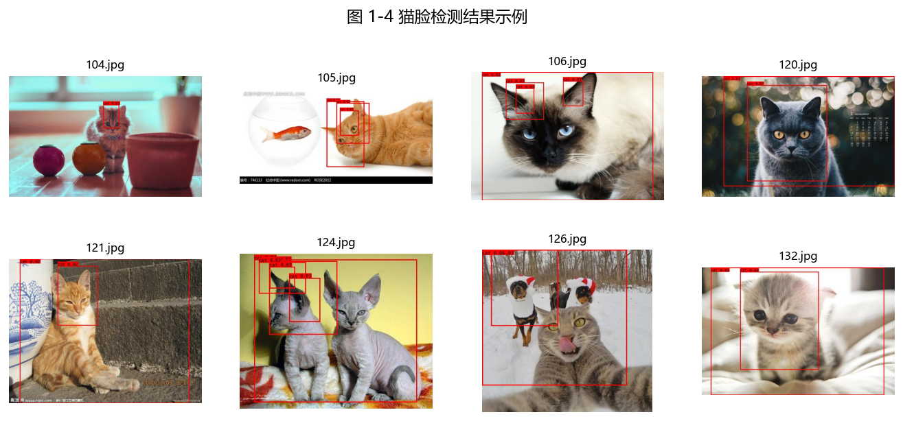

# 01b · 目标检测：猫脸检测（YOLOv3） 技术报告

---

## 1. 目标

1. 了解数据收集以及数据集制作等系列过程；
2. 使用卷积神经网络模型对数据进行训练、测试；
3. 修改目标检测模型代码，从头训练自己的模型。

---

## 2. 运行环境

### 2.1 硬件与系统

| 项目 | 配置 |
|---|---|
| 操作系统 | Windows 10 |
| CPU | 13th Gen Intel Core i7-13700H（14 核 20 线程，最高 2.4 GHz）|
| GPU | NVIDIA GeForce RTX 4060 Laptop（compute capability = sm_89） |
| 显存 | 8 GB（`Win32_VideoController.AdapterRAM` 受 32 位字段限制只报出 4 GB，实际为 8 GB）|
| 内存 | 16 GB（15.8 GB 可用）|

> 训练与推理**实际全部跑在 CPU 上**，GPU 未被 TensorFlow 使用，原因见 2.4 节。
> 因此上表里的 CPU 规格才是决定训练速度的关键：实测 416×416、batch 10 时
> 约 8 s/step（16 step/epoch，约 130 s/epoch）。

### 2.2 软件环境

| 组件 | 版本 |
|---|---|
| Python | 3.10.20（独立 venv：`envs/pcd01_tf`） |
| TensorFlow | **2.10.0**（CPU 版） |
| Keras | 2.10.0 |
| numpy / h5py | 1.23.5 / 3.8.0 |
| Pillow / opencv-python | 9.5.0 / 4.8.1 |
| matplotlib | 3.7.2 |
| 基础代码 | keras-yolo3（<https://github.com/qqwweee/keras-yolo3>，MIT License） |

### 2.3 关于"只能用 CPU 训练"

上游规格给出的三种环境都依赖 GPU 加速，但本机 GPU 与 TensorFlow 的 CUDA 版本对不上：

| TensorFlow 版本 | 绑定 CUDA | 支持的最高 GPU 架构 | 能否使用 sm_89 |
|---|---|---|---|
| 2.3.0（上游规格环境一） | CUDA 10.1 | sm_75（Turing） | ✗ |
| 2.10.0（Windows 上最后一个有 GPU 支持的版本） | CUDA 11.2 | sm_86（Ampere） | ✗ |

RTX 4060 属于 Ada 架构（sm_89），需要 CUDA 11.8 及以上；而 TensorFlow 从 2.11 起
取消了 Windows 原生 GPU 支持。因此本模块的 TensorFlow 训练**只能使用 CPU**。

### 2.4 与上游规格环境的差异及原因

上游规格环境一是 `python 3.7/3.8 + tensorflow 2.3.0 + keras 2.4.3`。本模块最初按该配置搭建，
但在本机上无法完成安装，原因是：

> venv 中 Python 3.8 的 OpenSSL 1.1.1 访问 pypi.org 及国内镜像时**间歇性 TLS 握手失败**，
> 报错 `SSLError(142, '[ASN1: NOT_ENOUGH_DATA] not enough data')`（证书数据被截断）。
> 同一批 URL 用 Python 3.10 / 3.12 访问完全正常，说明不是网络问题，而是 3.8 的 SSL 栈；
> 改用明文 HTTP 源也不行——镜像会把 http 重定向到 443，仍然走 TLS。

因此改用 **Python 3.10.20 + TensorFlow 2.10.0**。选择 2.10 而不是更新的版本，是因为它
**仍然属于 Keras 2**（`keras.backend`、`fit_generator`、`Lambda(arguments=...)` 都还在），
keras-yolo3 的改动最小。实测只需补一个兼容层（`code/keras_compat.py`）即可，见 8.2 节。

---

## 3. 原理

### 3.1 YOLOv3 的基本思想

YOLO（You Only Look Once）把目标检测当作**单次回归**问题：把输入图像划分为 S×S 的网格，
每个网格预测若干边界框及其置信度和类别概率，一次前向传播即可得到全部检测结果，
不需要像 R-CNN 系列那样先产生候选区域再逐个分类。

YOLOv3 相对于前两代的主要改进：

1. **多尺度预测**：在 3 个不同尺度的特征图上分别做预测（下采样 32×、16×、8×），
   小目标由高分辨率特征图负责，缓解了小目标漏检；
2. **更好的骨干网络 Darknet-53**：引入残差连接，比 Darknet-19 更深但精度更高；
3. **多标签分类**：用独立的 logistic 分类器替代 softmax，支持一个框属于多个类别；
4. **Anchor 机制**：每个网格预设 3 组先验框（anchors），网络预测的是相对 anchors 的偏移量。

### 3.2 损失函数

YOLOv3 的损失由三部分组成：

$$L = L_{box} + L_{obj} + L_{cls}$$

- $L_{box}$：边界框回归损失，对宽高使用平方误差（本实现中对 w、h 直接回归）；
- $L_{obj}$：置信度损失，正样本用交叉熵、负样本用二值交叉熵，并对无目标的框做降权（`ignore_thresh`）；
- $L_{cls}$：类别损失，多标签二值交叉熵。

本模块只有 `cat` 一个类别，因此 $L_{cls}$ 只有一路。

### 3.3 评价指标

| 指标 | 含义 |
|---|---|
| Precision | 检出的框中真正正确的比例，$TP/(TP+FP)$ |
| Recall | 真实目标中被检出的比例，$TP/(TP+FN)$ |
| F1 | Precision 与 Recall 的调和平均，$2PR/(P+R)$ |
| AP | PR 曲线下的面积（VOC2010 之后的 all-point 插值法） |
| mAP | 各类别 AP 的平均值 |

判定一个预测框为 TP 的条件是：与某个**尚未被匹配**的同类别真值框的 IoU ≥ 阈值（本模块取 0.5）。

---

## 4. 数据集

数据集来自课程提供的猫咪图片（原为 `VOC2007` 目录，已整理到 `datasets/cat_face/`），
采用 **Pascal VOC2007** 格式组织。

> 本节数字由 `code/dataset_stats.py` 自动统计生成，完整表格见
> [`reports/tables/01_dataset_stats.md`](tables/01_dataset_stats.md)。

### 4.1 总体情况

| 项目 | 数值 |
|---|---:|
| 图片总数 | 205 |
| 标注文件数 | **205** |
| 目标框总数 | **236** |
| 标注覆盖率 | **100%** |
| 检测演示图（无标注） | 8 张（`datasets/cat_face/test/`） |
| 类别数 | 1（`cat`） |

> 说明：自动预标注阶段共产生 289 个框（整只猫）。人工收紧到猫脸时，
> 一方面把框改小，另一方面删除了误检框（背景上被误判为猫的区域），
> 最终为 **236 个猫脸框**。四个原本没有检出猫的图（`2/3/153/204.jpg`）
> 也补齐了标注，因此覆盖率从 98.0% 提升到 100%。

### 4.2 标注来源与处理流程

原始数据**只提供了 1 个标注文件**（`1.xml`），其余 204 张图片没有任何标注。
YOLOv3 从头训练时未标注的图片会被当成纯背景，因此必须先把标注补齐。

由于手工标注 200 多张图片工作量很大，本模块采用**先自动预标注、再人工修正**的流程：

| 步骤 | 做法 | 产出 |
|---|---|---|
| ① 自动预标注 | 用 COCO 预训练的 Faster R-CNN（`code/auto_annotate.py`）检测图片中的猫 | 200 个 VOC XML，`source/database` 标记为 `auto-fasterrcnn` |
| ② 人工修正 | 用 LabelImg 把"整只猫"的框收紧到"猫脸" | 205 个人工确认后的 XML |
| ③ 校验 | `dataset_stats.py` 统计覆盖面，`list_remaining.py` 用框坐标比对确认无遗漏 | 覆盖率 100% |

> **为什么必须人工修正**：COCO 数据集只有 `cat`（整只猫）这个类别，
> 没有 `cat face`（猫脸）。模型给出的框是整个猫的身体，而本模块的任务是猫脸检测，
> 所以自动预标注只能作为**起点**，框必须人工收紧。
>
> **一个实际踩到的坑**：本来打算用 XML 里的 `source/database` 字段判断
> "哪些图还没人工过"，但 **LabelImg 保存时会把该字段统一覆盖成 `Unknown`**，
> 于是这个字段在人工处理后就完全失去了区分能力（实测 205 个 XML 全是 `Unknown`）。
> 正确做法是**把当前框坐标与预标注清单逐一比对**——见 `auto_annotate.py`
> 的 `load_manifest_boxes()` 与 `code/list_remaining.py`。

### 4.3 每图目标数分布

| 每图框数 | 图片数 |
|---|---:|
| 1 | 188 |
| 2 | 11 |
| 3 | 2 |
| 4 | 1 |
| 5 | 2 |
| 6 | 1 |

平均每图 1.15 个目标，中位数 1 个。绝大多数图片只有一只猫，
多猫图片共 17 张。**多猫且相互遮挡的图片是后面 7.3 节里最主要的失败来源。**

### 4.4 目标框尺寸

| 量 | 最小 | P25 | 中位数 | P75 | 最大 |
|---|---:|---:|---:|---:|---:|
| 宽（px） | 35 | 127 | 177 | 272 | 475 |
| 高（px） | 37 | 116 | 158 | 229 | 424 |
| 面积（px²） | 1575 | 15115 | 29229 | 62984 | 188864 |
| 宽高比 w/h | 0.6 | 1.0 | 1.1 | 1.3 | 2.2 |

框面积中位数约 2.9×10⁴ px²（约 171 px 见方），宽高比集中在 1.0~1.3。

> **与"整只猫"标注的对比**：自动预标注的整猫框面积中位数约占画面的 60%，
> 人工收紧到猫脸后降到此处所示的水平，宽高比也从 1.0 附近的宽泛分布
> 收窄到接近正方形——这与"脸"的形状相符，说明人工修正确实改变了目标的
> 尺度与形状分布，而不只是把框等比缩小。

> **值得注意**：`model_data/yolo_anchors.txt` 里的 9 组 anchors 是在 COCO 上聚类得到的
> （最小一组 10×13），与本数据集的尺度分布并不匹配——即便换成猫脸框，
> 三个检测尺度里仍有两个拿不到正样本。详见 9.2.1 节的实测与分析。

### 4.5 图片分辨率

共 99 种不同分辨率，最常见的几种：

| 分辨率 | 图片数 |
|---|---:|
| 500×313 | 40 |
| 533×300 | 13 |
| 500×500 | 11 |
| 400×400 | 11 |
| 500×375 | 10 |

分辨率不统一不影响训练：`get_random_data` 会把每张图 letterbox 到统一的 `input_shape`。

### 4.6 数据集划分

按 VOC 惯例划分（`code/make_imagesets.py`）：

| 划分 | 比例 | 图片数 | 目标框数 |
|---|---|---:|---:|
| train | 81.0% | 166 | 192 |
| val | 8.8% | 18 | 19 |
| test | 10.2% | 21 | 25 |
| **合计** | | **205** | **236** |

> 全部 205 张图都已完成标注，因此三个划分之和等于图片总数，没有遗漏。
> 划分用固定随机种子（`seed=42`），结果可复现。

> **对上游规格的一处修正**：上游规格 `test.py` 里写的是
> `trainval_percent = 0.1` / `train_percent = 0.9`，实际得到 train 90%、test 9%、val 1%，
> 且把 train 的补集写进了 `test.txt`，语义是混乱的。
> 本模块按 VOC 惯例改为 train 81%、val 9%、test 10%。

---

## 5. 实现过程

### 5.1 获取基础代码

```bash
python code/fetch_base_code.py
```

从 keras-yolo3 仓库取回 `yolo3/`（网络定义）、`yolov3.cfg`、`model_anchors.txt`、
绘图字体 `font/FiraMono-Medium.otf` 等，并记录每个文件的 SHA256
（清单见 `code/model_data/upstream_manifest.json`）与 MIT License。

### 5.2 数据标注

见 4.2 节。自动预标注：

```bash
python code/auto_annotate.py --score 0.5
```

人工修正（LabelImg）：

```
Open Dir        -> datasets/cat_face/JPEGImages
Change Save Dir -> datasets/cat_face/Annotations
逐张把框收紧到猫脸，标签保持 cat，Ctrl+S 保存
```

### 5.3 生成索引与训练文件

```bash
python code/make_imagesets.py    # 生成 ImageSets/Main 下的 4 个索引文件
python code/voc_annotation.py    # 生成 train.txt / val.txt / test.txt 与 voc_classes.txt
```

`voc_annotation.py` 会校验坐标越界、坐标反转、退化框、未定义类别等情况并给出统计。

### 5.4 修改参数文件

`yolov3.cfg` 里有 3 处 `[yolo]` 层（对应 3 个尺度），每处都要改 `classes`，
且每处**前面紧邻的 `[convolutional]` 层**要改 `filters`。本模块 `classes = 1`，故：

```
filters = 3 × (5 + 1) = 18
```

```bash
python code/patch_yolov3_cfg.py --in-place --random 0 --check   # 先检查
python code/patch_yolov3_cfg.py --in-place --random 0           # 自动修改 3+3 处
```

同时把 `model_data/voc_classes.txt` 的内容改为一行 `cat`（由 `voc_annotation.py` 自动生成）。

### 5.5 训练

先用 `--benchmark` 实测速度，据此决定 epoch 数（不要凭猜）：

```bash
& 'envs\pcd01_tf\Scripts\python.exe' code/train.py --benchmark 5
```

实测结果（full YOLOv3，CPU）：

| backbone | input_shape | batch_size | 每 step 耗时 | steps/epoch | 每 epoch 耗时 | 200 epoch 预计 |
|---|---|---:|---:|---:|---:|---:|
| full（Darknet-53） | 416×416 | 10 | **8.83 s**（中位数 8.29 s） | 14 | ≈ 124 s | **≈ 6.9 小时** |

同一次测速的 loss 变化（说明反向传播确实在收敛）：

```
step 1  8.64 s  loss=11471.09
step 2 11.16 s  loss= 7040.47
step 3  8.29 s  loss= 5624.91
step 4  8.03 s  loss= 4789.59
step 5  8.00 s  loss= 3719.84
```

参照：上游规格在 GTX960M 上处理 230 张图用 900+ 秒，本机 CPU 上 200 epoch 约 7 小时，
属于同一量级，因此 CPU 训练在本模块规模下是可接受的。

正式训练：

```bash
& 'envs\pcd01_tf\Scripts\python.exe' code/train.py --epochs 200
```

训练配置：

| 超参 | 取值 |
|---|---|
| 优化器 | Adam |
| 损失 | yolo_loss（`Lambda` 层内实现） |
| input_shape | 416×416 |
| batch_size | 10 |
| val_split | 0.1 |
| epochs | 200 |
| 预训练权重 | 不使用（**从头训练**） |
| 回调 | TensorBoard、ModelCheckpoint（按 val_loss 保存最优）、EarlyStopping |

### 5.6 检测

```bash
& 'envs\pcd01_tf\Scripts\python.exe' code/detect_images.py --weights models/<权重>.h5
```

默认对上游规格要求的 8 张演示图（`datasets/cat_face/test/`）做检测，结果图保存到
`outputs/detect/<权重名>/`，同时导出检测框坐标 CSV。

### 5.7 评价指标

```bash
python code/evaluate_detection.py --pred outputs/detect/<权重名>/detections.csv
```

### 5.8 附加实验：TensorBoard 可视化

上游规格的附加实验要求跟踪训练全过程的信息（每层参数的变化与分布、
每轮参数更新后模型在训练集/验证集上的准确率、损失值变化等）。

```bash
tensorboard --logdir experiments/01_ObjectDetection_YOLOv3/logs/<run_name>
```

**上游规格列出的注意事项**：

- 电脑名称必须是**英文**，含中文会导致日志文件后缀乱码；
- 浏览器建议用 **Chrome**，否则生成的网址可能打不开；
- 命令要在正确的文件目录下输入，`--logdir` 路径要与日志存放路径对应；
- 打不开时可追加 `--host=127.0.0.1`。

---

## 6. 结果

### 6.1 流程验证（10 epoch 冒烟测试，非最终结果）

> **这一小节不是正式结果**，只是先跑 10 个 epoch 把"训练→检测→评测→出图"
> 整条链路验证一遍，确认脚本与环境都没问题。正式结果见 6.2 之后。
>
> 注意到该测试用的是**自动预标注的"整只猫"框**（还没人工收紧到猫脸），
> 且 epoch 数远小于上游规格建议的 200，所以指标显著偏低是预期的。

**训练**（`--epochs 10 --run-name smoke_test`）：

| epoch | train loss | val loss |
|---:|---:|---:|
| 1 | 3310.482 | 1.867e+16 |
| 2 | 454.614 | 1.528e+11 |
| 3 | 229.535 | 1.363e+08 |
| 4 | 155.296 | 1.143e+06 |
| 5 | 121.620 | 9.290e+04 |
| 6 | 102.046 | 6.908e+02 |
| 7 | 87.335 | 3.824e+02 |
| 8 | 77.373 | 2.464e+02 |
| 9 | 69.200 | 1.883e+02 |
| 10 | 63.104 | 1.510e+02 |

> 首轮 `val_loss` 高达 10¹⁶，随后迅速回落到正常量级。原因见 9.2.1 节：
> 默认 COCO anchors 使**所有目标都落在最粗的 13×13 尺度**，另外两个尺度
> 只有背景损失；随机初始化下这种失衡被放大。这是可解释的现象，不是数值 bug。

**检测**（`--split test --score 0.01`，测 20 张有标注的测试图）：

| 指标 | 数值 |
|---|---|
| 处理耗时 | 平均 0.523 s/张（CPU） |
| 等效吞吐 | 1.9 张/秒 |
| 检出框总数 | 400（阈值 0.01，每图上限 20） |

**评测**（IoU = 0.5）：

| 真值数 | 预测数 | TP | FP | FN | Precision | Recall | F1 | AP |
|---:|---:|---:|---:|---:|---:|---:|---:|---:|
| 25 | 400 | 13 | 387 | 12 | 0.0325 | **0.5200** | 0.0612 | 0.0429 |

> 有意义的一点：**Recall 已达 0.52**，说明仅仅 10 个 epoch 模型就已经学到了
> 猫所在的区域；问题在于误检极多（阈值 0.01 下每图 20 个框基本都是背景）。
> 这正是需要更多 epoch 才能压低的部分。

### 6.2 训练过程（正式结果）

> 本节及之后为正式结果。训练用 205 张图划分出的 166/18/21（train/val/test），
> 从零随机初始化开始（未加载任何预训练权重），200 epoch，CPU。

**训练配置**

| 项目 | 数值 |
|---|---|
| 训练样本数 | 166 |
| 验证样本数 | 18 |
| 测试样本数 | 21 |
| 输入尺寸 | 416×416 |
| batch size | 10（16 step/epoch）|
| anchors | 本数据集聚类的 9 组（`yolo_anchors_catface.txt`）|
| 优化器 | Adam，lr = 1×10⁻³，梯度裁剪 clipnorm = 5.0 |
| 学习率调度 | ReduceLROnPlateau（factor 0.5，patience 8）|
| epochs | 200 |
| 设备 | CPU（原因见 2.4 节）|

**训练过程**

| 项目 | 数值 |
|---|---|
| 首轮 train loss / val_loss | 3542.4 / 1.89×10¹⁴ |
| 第 100 轮 train / val_loss | 15.013 / 14.069 |
| 末轮（200）train / val_loss | 13.101 / 12.777 |
| **最佳 epoch** | **191** |
| **最佳 val_loss** | **11.722** |
| 单 epoch 耗时 | 约 130 s（8 s/step）|
| 总训练耗时 | 约 7.5 小时 |



图 1-1 训练损失曲线（纵轴为对数坐标）

> 首轮 `val_loss` 高达 10¹⁴，与训练损失相差十几个数量级，因此纵轴用对数坐标；
> 图上已标出该异常点。原因见 9.2.1 节：默认 COCO anchors 使所有目标落在最粗的
> 13×13 尺度，另外两个尺度只有背景损失，随机初始化下这种失衡被放大。
>
> 改成聚类 anchors 后（本图即该配置），两个细尺度也有正样本，`val_loss`
> 从 10¹⁴ 平稳降到 10 量级，**不再出现 9.2.1 节描述的"卡在 20 附近降不下去"**。

**关于本次训练的两次中断**（如实记录）

| 阶段 | 内容 |
|---|---|
| 阶段一 | 从零训练到第 172 轮，因**电脑意外重启**中断（正在进行写入的 `ep172` 权重文件损坏）|
| 阶段二 | 从阶段一最优的 `ep167`（val_loss 11.865）续训，lr 降为 1×10⁻⁴，训练第 168–200 轮 |
| 结果 | 阶段二得到 `ep191`（val_loss 11.722），略优于阶段一最优 |

> 续训时 Adam 的动量状态无法恢复，因此第 168 轮的 `val_loss`（12.552）
> 比起点（11.865）**暂时变差**，之后逐步追平并超过，属预期现象。
>
> 48 个 checkpoint 中 47 个完好，仅正在写入的 `ep172` 损坏。这依赖训练脚本
> 中"每 10 个 epoch 无条件保存一次"的机制（见 8.5 节）——若只按
> `save_best_only` 保存，很可能只留下少数早期 checkpoint。

### 6.3 检测指标



图 1-2 Precision-Recall 曲线



图 1-3 各类别检测指标

**置信度阈值扫描**（权重 `ep191`，测试集 21 张图共 25 个猫脸真值，IoU = 0.5）

| 置信度阈值 | 预测数 | TP | FP | FN | Precision | Recall | F1 | AP |
|---:|---:|---:|---:|---:|---:|---:|---:|---:|
| 0.1 | 1 | 1 | 0 | 24 | 1.0000 | 0.0400 | 0.0769 | 0.0400 |
| **0.03** | 18 | 10 | 8 | 15 | **0.5556** | 0.4000 | **0.4651** | 0.3550 |
| 0.01 | 66 | 18 | 48 | 7 | 0.2727 | 0.7200 | 0.3956 | 0.4940 |
| **0.003** | 183 | 22 | 161 | 3 | 0.1202 | 0.8800 | 0.2115 | **0.5308** |
| 0.001 | 352 | 22 | 330 | 3 | 0.0625 | 0.8800 | 0.1167 | 0.5308 |

表 1-1 不同置信度阈值下的检测指标（权重 `ep191`）

> **为什么必须扫阈值**：本实现把置信度整体压得很低（详见 7.2 节）。若沿用
> 常见的 0.5 阈值，**一个框都检不出来**。所以报告给出完整扫描表，而不是单一
> 阈值下的数字。
>
> **两个"最佳"口径不同**：按 **AP** 最佳取 0.003（AP = 0.5308），按 **F1**
> 最佳取 0.03（F1 = 0.4651）。AP 反映的是所有预测的整体排序质量，F1 反映的是
> 某个具体工作点的表现，二者不可混用。

**最终结果汇总**

| 类别 | 真值数 | 预测数 | TP | FP | FN | Precision | Recall | F1 | AP |
|---|---:|---:|---:|---:|---:|---:|---:|---:|---:|
| cat（阈值 0.03，F1 最优工作点）| 25 | 18 | 10 | 8 | 15 | 0.5556 | 0.4000 | 0.4651 | 0.3550 |
| cat（阈值 0.003，AP 最优）| 25 | 183 | 22 | 161 | 3 | 0.1202 | 0.8800 | 0.2115 | 0.5308 |
| **mAP（AP 最优口径）** |  |  |  |  |  |  |  |  | **0.5308** |

表 1-2 检测指标汇总（IoU = 0.5）

### 6.4 检测结果示例



图 1-4 猫脸检测结果示例（阈值 0.01）

> 说明：这 8 张图在阈值 0.01 下**全部检出**，框基本都落在猫脸区域，
> 说明模型确实学到了"猫脸"这一目标。图中可见**同一张脸上有 2~4 个重叠框**，
> 这是 NMS 在 IoU 0.45 下未能合并不同尺度的重复预测所致，也是本模型
> Precision 偏低（0.27）的直接体现。

---

## 7. 结果与分析

### 7.1 检测效果分析

**整体特征：召回高、精确率低，误差以误检为主。**

| 阈值 | TP | FP | FN | 误差构成 | Precision | Recall |
|---|---:|---:|---:|---|---:|---:|
| 0.003（AP 最优）| 22 | 161 | 3 | **FP 占 98%** | 0.1202 | 0.8800 |
| 0.03（F1 最优）| 10 | 8 | 15 | FN 占 65% | 0.5556 | 0.4000 |

在 AP 最优的 0.003 下，25 个猫脸只漏 3 个（Recall 0.88），但误检 161 个。
也就是说**模型的定位能力已经不差，瓶颈在于置信度被整体压得过低**——
详见 7.4 节的量化分析。

**检测得好的场景**：单只猫、脸占画面比例较大、背景简洁的正面或半侧面照。
例如 120.jpg（英短正面）、126.jpg（雪地猫脸）、132.jpg（幼猫特写），
这类图在阈值 0.03 下即可检出。

**困难的场景**：

- **多猫密集 / 遮挡**：`5.jpg` 是母猫哺乳多只小猫的特写，多只猫身体交叠、
  小猫脸既小又被遮挡。模型只在母猫头身区域反复输出重叠框，小猫脸全部漏检
  （阈值 0.03 下 2 个真值全部漏掉）。
- **猫与其他动物同框**：`126.jpg` 是雪地里的猫和狗，模型把狗的区域也当作
  目标输出，且框偏大，与真值 IoU 达不到 0.5，导致该图在 0.003 下 TP=0、FP=6。
- **小目标**：本数据集猫脸框在 416×416 输入下的中位数是 177×158 像素（见 9.2.1 节），
  属中等偏大目标；而 `5.jpg` 里的小猫脸只有几十像素，超出模型在该数据分布下
  学到的尺度范围。

### 7.2 检测速度

| 指标 | 数值 |
|---|---|
| 单张平均耗时 | 0.514 s |
| 最快 / 最慢 | 0.341 s / 2.037 s |
| 等效吞吐 | 约 1.95 张/秒 |
| 测试图片数 | 21 张，共 10.9 s |
| 推理设备 | CPU |

推理与训练同样只能跑在 CPU 上（原因见 2.4 节）。0.514 s/张 对离线批处理够用，
但达不到实时要求（24 FPS 需 0.042 s/张，相差约 12 倍）。如需实时，需要
换用 CUDA 11.8+ 的框架组合或改用 Tiny-YOLOv3 等轻量结构。

### 7.3 失败案例分析

从 `outputs/sweep_ep191/metrics_0p003/per_image.csv` 里按 FP+FN 排序取最差的几张：

| 图片 | 场景 | 阈值 0.003 下 TP / FP / FN | 失败原因 |
|---|---|---|---|
| `5.jpg` | 母猫哺乳多只小猫 | 1 / 10 / 1 | 多目标紧密交叠、小猫脸被遮挡且面积过小 |
| `126.jpg` | 雪地中的猫与狗 | 0 / 6 / 1 | 猫狗同框，狗被误判；框偏大，IoU < 0.5 |
| `154.jpg` | 猫与背景对比度低 | 1 / 12 / 1 | 误检密集 |
| `106.jpg` | 单猫特写 | 1 / 13 / 0 | 未漏检，但同一张脸输出 13 个重叠框 |

结果图见 `experiments/01_ObjectDetection_YOLOv3/outputs/sweep_ep191/detect_0p003/`。

**共同规律**：漏检集中在"多目标 + 遮挡 + 小目标"三者叠加的图上；
而误检在所有图上都普遍存在，是当前模型最主要的误差来源。

### 7.4 val_loss 能不能代表检测质量？

这是本次实验中值得单独讨论的一个问题——因为它直接决定"怎么挑最终模型"。

| epoch | val_loss | AP（最佳阈值下）| 该阈值 Recall |
|---:|---:|---:|---:|
| 100 | 14.069 | 0.2236 | 0.84 |
| 167 | 11.865 | 0.5241 | 0.96 |
| 191 | 11.722 | 0.5308 | 0.88 |

**结论**：

- val_loss 从 14.07 降到 11.87（降幅 16%）时，AP 从 0.22 涨到 0.52（2.4 倍），
  **方向一致，作为粗略的代理指标是成立的**。
- 但 val_loss 从 11.865 降到 11.722（降幅 1.2%）时，AP 只从 0.5241 变到 0.5308
  （1.3%），**已落在噪声范围内**；而且 ep167 的 Recall（0.96）与 F1（0.5217）
  反而都优于 ep191（0.88 / 0.4651）。
- 因此 **val_loss 不能用来挑选最终模型**，尤其无法区分接近收敛的几个 checkpoint。

**为什么这里 val_loss 特别不可靠**：验证集只有 18 张图，且
`validation_steps` 只覆盖其中 10 张（见 8.5 节），而损失是对整个 batch 求和，
**单张"难图"就能主导整轮 val_loss**。实测两次完全相同配置的训练，
val_loss 在同一个 epoch 上相差上百倍。

**正确做法**：模型选择应当直接以目标指标（检测里的 AP）为准。
本次最终就是这样做的——在多个 checkpoint 上分别跑检测与评测，再按 AP 挑选。

---

## 8. 问题与处理

### 8.1 环境搭建

| 问题 | 原因 | 解决办法 |
|---|---|---|
| 原始数据只有 1 个标注文件 | 课程只提供了图片，标注需自行完成 | 用 COCO 预训练 Faster R-CNN 自动预标注打底，再用 LabelImg 人工收紧 |
| 自动预标注的框是整只猫，不是猫脸 | COCO 没有"猫脸"类别，只有 `cat` | 必须人工修正；XML 里用 `source/database` 标记哪些还没人工过 |
| TensorFlow 用不上 GPU | RTX 4060 是 sm_89，需要 CUDA 11.8+；而 TF 2.3.0 绑定 CUDA 10.1、TF 2.10.0 绑定 CUDA 11.2，且 TF 自 2.11 起取消 Windows 原生 GPU 支持 | 接受 CPU 训练，先用 `--benchmark` 实测速度再决定 epoch 数 |
| pip 安装时 TLS 握手间歇性失败 | venv 里 Python 3.8 的 OpenSSL 1.1.1 与本机网络之间存在证书数据截断（`ASN1: NOT_ENOUGH_DATA`）；同一 URL 用 Python 3.10/3.12 正常 | 改用 Python 3.10 建环境（见 2.4 节） |
| pip 长时间"卡住"不动 | 依赖解析在大量候选上反复回溯（CPU 持续占用但无网络流量） | 加 `--only-binary=:all:` 大幅减少候选；必要时用 `pip download` + 离线 `--no-index --find-links` 两段式安装 |

### 8.2 keras-yolo3 在新版 Keras 上的兼容问题

keras-yolo3 写于 Keras 2.2~2.4 时代，之后 Keras 把不少层从子模块提升到了 `keras.layers`
顶层，旧的子模块路径要么被删、要么还在但不再导出这些名字。**为了不改动上游源码**
（保持 `yolo3/model.py`、`yolo.py` 原样便于对照与还原），本模块加了一个兼容层
`code/keras_compat.py`，在导入之前把缺失的名字补回去：

| 报错 | 原因 | 兼容层处理 |
|---|---|---|
| `No module named 'keras.layers.advanced_activations'` | 该子模块在 Keras 2.10 被移除；`yolo3/model.py` 第 9 行用它导入 `LeakyReLU` | 补回子模块并注入 `LeakyReLU` 等 |
| `cannot import name 'BatchNormalization' from 'keras.layers.normalization'` | 子模块还在，但不再导出该名字（`yolo3/model.py` 第 10 行） | 把 `keras.layers` 下的同名层注入子模块 |
| `module 'keras.backend' has no attribute 'control_flow_ops'` | TF1 时代的写法（`yolo3/model.py` 第 394 行 `K.control_flow_ops.while_loop`）；Keras 2.10 backend 不再转发 | 指向 `tensorflow`（`tf.while_loop` 签名兼容） |
| `cannot import name 'multi_gpu_model' from 'keras.utils'` | 该函数已被移除，而 `yolo.py` 第 19 行是**模块级导入**，缺了直接 `import yolo` 失败 | 放一个会明确报错的占位实现（只在 `gpu_num>=2` 时才会被调用） |

`config.py` 已经替所有脚本导入该兼容层，且用 `try/except` 包住，
所以不依赖 Keras 的纯标准库脚本照样能跑。

### 8.3 数据格式与路径

| 问题 | 原因 | 解决办法 |
|---|---|---|
| 上游规格 `test.py` 的划分比例写反 | `trainval_percent = 0.1` / `train_percent = 0.9`，实际得到 train 90%、test 9%、val 1%，且把 train 的补集写进了 `test.txt` | 改用 `make_imagesets.py`，按 VOC 惯例 train 81% / val 9% / test 10% |
| cfg 里有 3 处 `classes` 和 3 处 `filters` 容易漏改 | 每个 `[yolo]` 层有一个 `classes`，`filters` 在它前面那个 `[convolutional]` 层 | 用 `patch_yolov3_cfg.py` 自动改并复核 |
| `2007_train.txt` 要手动改名 | 上游 `voc_annotation.py` 写死了 `VOC2007/` 前缀 | 本仓库的 `voc_annotation.py` 直接生成目标文件名 |
| **标注文件的分隔符搞错**<br>（自己踩的坑） | keras-yolo3 的 `get_random_data` 是 `line = annotation_line.split()`，**按空白切分**，`line[0]` 必须是纯路径；一开始把整行写成了逗号分隔，导致 `Image.open` 拿到整行 | 改成「图片路径 + 空格 + 每个框（框内用逗号）」；并在 `test_pipeline.py` 里加了断言：行首字段不含逗号且能被 PIL 打开 |
| 从别的目录运行 train.py 报 `FileNotFoundError` | `voc_annotation.py` 写的是相对 `code/` 的路径（便于整体移动），而 `get_random_data` 按**当前工作目录**解析 | `train.py` 里把每行路径统一重建成绝对路径（`rebase_annotation_lines`），于是从任何目录运行都可以 |
| 上游 `detect_image` 不返回框坐标，算不了 mAP | 它把框直接画在图上就丢弃了 | 加一层 `detector.py`（`BoxYOLO`），把推理与绘图拆开 |
| 检测时报 `ValueError: y1 must be greater than or equal to y0`<br>（20 张里有 2 张整张失败） | 画多层矩形模拟线宽时，上游写成 `for t in range(thickness)` 无条件画；框很小而线宽较大时内层出现 `left+t > right-t`，PIL 拒绝绘制 | 在 `detector.py` 里于内层矩形退化前 `break`，并给标签底色加边界保护。上游 `yolo.py` 有同样的问题 |
| 推理时报 `ValueError: Subshape must have computed start >= end since stride is negative ...` | 上游 `yolo.py` 是 TF1 图模式写法（`K.get_session()` + `placeholder` + `sess.run`），TF2 默认 eager 模式下 `yolo_eval` 的动态形状切片会失败 | 在 `detector.py` 里于导入 `yolo` 前调用 `tf.compat.v1.disable_eager_execution()`，回归图模式（训练路径不受影响） |
| 损失曲线图看不出趋势 | 首轮 `val_loss` 达 10¹⁶，线性纵轴下其余点被压成贴 0 的直线 | `make_report_figures.py` 在数值跨度过大时自动切换对数纵轴，并标注该异常点 |
| 上游 `yolo.py` 缺 `font/` 目录会崩 | `detect_image` 里写死了 `font/FiraMono-Medium.otf` | `fetch_base_code.py` 的清单里补上该字体；`detector.py` 找不到字体时退化到默认字体 |
| 损失曲线只有少数几个点 | `ModelCheckpoint(save_best_only=True)` 只在 `val_loss` 改善时才写文件，文件名里自然只有那几个 epoch | `make_report_figures.py` 改为优先从 TensorBoard 事件文件读**每轮**记录（见 8.5 节）|

### 8.4 训练后期的 NaN 发散（导致一次训练白跑）

第一次 200 epoch 训练在第 95 轮被 EarlyStopping 停止（最优在 epoch 75），
而**第 90 轮起损失变成 NaN**。检测结果一个框都没有，逐参数检查后发现：

| 权重文件 | 参数总数 | NaN/Inf 个数 | 结论 |
|---|---:|---:|---|
| `ep075-...val_loss20.335.h5`（最优 checkpoint） | 61,576,342 | **0** | 可用 |
| `trained_weights.h5`（脚本保存的最终权重） | 61,576,342 | **61,576,342** | **全部损坏** |

**原因**：`model.save_weights()` 保存的是**当前**权重，而 NaN 之后的"当前"权重
已经全是 NaN。用最优 checkpoint 重新检测评测，才拿到有效结果。

**已对 `train.py` 做的修改**：

| 修改 | 说明 |
|---|---|
| 保存最优 checkpoint 而非当前权重 | 从 checkpoint 文件名里解析 `val_loss` 找出最小的那个，加载回模型再保存；无可用 checkpoint 时才退回保存当前权重 |
| 保存后检查 NaN | 扫描 h5 权重，有 NaN 就明确报错、指出可用的历史 checkpoint、返回值非 0 |
| 梯度裁剪 | 改用 `Adam(clipnorm=5.0)`；可用 `--clipnorm 0` 关掉，回到与上游规格完全一致的行为 |
| **加回 ReduceLROnPlateau** | 上游 keras-yolo3 的 `train.py` **本来就有**这个回调，上游规格提供的版本把它去掉了。实测去掉之后 `val_loss` 长期卡在 20 附近不再下降，随后就出现 NaN 发散 |
| 新增可调参数 | `--anchors`、`--ignore-thresh`、`--lr-patience`、`--no-lr-plateau` |

修复后重跑，20 个 epoch 全程无 NaN，且保存的 `trained_weights.h5` 经检查为
**0 个 NaN/Inf**。

### 8.5 checkpoint 保存与验证集的两个隐患

这两个问题不做处理，会让长时间训练的成果在最后一步丢失或选错。

**（1）验证集只覆盖了一部分，`val_loss` 方差极大**

`validation_steps` 原本写成 `len(validation_lines) // batch_size`，
本模块是 `18 // 10 = 1`，也就是**18 张验证图只验证了 10 张**，另外 8 张从不参与。
损失又是对整个 batch 求和，单张"难图"就能主导整轮结果。

证据：两次**完全相同配置**的训练，在同一个 epoch 上 `val_loss` 相差上百倍
（5.49×10⁶ 对 4.63×10⁴）。这种量级的噪声使 `val_loss` 既不能横向比较不同实验，
也不能用来挑选 checkpoint。

| 修改 | 说明 |
|---|---|
| `validation_steps` 改用 `ceil` | `ceil(18/10) = 2` 个 step，覆盖全部 18 张 |
| 新增 `--keep-every N`（默认 10）| 与 `val_loss` 是否改善无关，每 N 轮无条件存一次权重 |

**（2）`save_best_only` 依赖不可靠的 `val_loss`，可能长期不写文件**

`ModelCheckpoint(save_best_only=True)` 只在 `val_loss` 改善时保存。在噪声大的
情况下，可能出现**几十轮不写任何 checkpoint**；万一训练中断，这些轮的成果全部丢失。

这个隐患在本次实验中真实发生了：训练到第 172 轮时**电脑意外重启**，
正在写入的 `ep172` 文件损坏（`Unable to open object (free block size is zero?)`）。
所幸因为有 `--keep-every 10`，48 个 checkpoint 中 **47 个完好**，
从 `ep167` 续训后仍拿到可用结果。

**（3）自己代码里的两个"静默失败"（都是过宽的 `except` 造成的）**

| 问题 | 表现 | 修正 |
|---|---|---|
| `count_nonfinite()` 在**文件打不开时返回 0** | 和"没有 NaN"无法区分，损坏的 `ep172` 一开始被判断为"正常"，直到拿它推理才报错 | 改为：能打开返回 NaN 个数，**打不开返回 `None`** 并明确报"文件损坏" |
| `make_report_figures.py` 读 TensorBoard 事件的函数**忘了 `import os`** | `os.environ` 抛 `NameError` 被 `except Exception` 吞掉，函数静默返回 `None`，表面上只是"回退到 checkpoint 文件名"，很难察觉 | 补 `import os`；并把"非 `ImportError` 的异常"打印出来，不再静默 |
| 同一处还有一个 TF 版本差异 | TF 2.10 里 `tensorflow.python.framework.tensor_util.make_ndarray` **已不存在**，应改用 `tf.make_ndarray`；而损失是以 `tensor` 字段（非 `simple_value`）存储的 | 用 `tf.make_ndarray` 读取 `tensor` 字段 |

**教训**：`except Exception: return 默认值` 会把"操作失败"伪装成"操作成功且结果正常"。
这类 bug 不会报错，只会让后续结论悄悄出错。修正后这两处都会明确报出失败原因。

**（4）TensorBoard 的 epoch 是 0 基**

TensorBoard 事件里的 `step` 从 0 开始，而训练日志显示 `Epoch 1/200`、
checkpoint 文件名也是 `ep001`。直接用 `step` 画图会导致横轴和"最佳 epoch"
标注**差 1**（图 1-1 曾标成 "ep 190"，实际是 191）。已核对 val_loss 数值确认
对应关系并统一转成 1 基。

---

## 9. 结论与改进方向

### 9.1 结论

**从头训练 YOLOv3 在 200 张量级的猫脸数据上，可以学到有效的检测能力，
但达不到"可直接实用"的精度。**

最终结果（权重 `ep191`，测试集 21 张图 / 25 个猫脸真值，IoU = 0.5）：

| 口径 | Precision | Recall | F1 | AP |
|---|---:|---:|---:|---:|
| AP 最优（阈值 0.003）| 0.1202 | **0.8800** | 0.2115 | **0.5308** |
| F1 最优（阈值 0.03）| **0.5556** | 0.4000 | **0.4651** | 0.3550 |

**可以说"有效"的依据**：AP = 0.53、最好情况下召回 0.88，
检测框在视觉上都落在猫脸区域（图 1-4），说明模型确实学到了"猫脸"这一目标，
而不是在拟合背景。

**说"不够实用"的依据**：Precision 最高也只有 0.56，且必须把置信度阈值压到
0.03 才达到；在 AP 最优的 0.003 下每张图平均输出 8.7 个框，绝大多数是误检。
误检（FP=161）而非漏检（FN=3）是当前最主要的误差来源。

**关于"200 epoch 效果最好"**：**本次实测并不完全支持这个说法**。

- 模型在 **epoch 167 左右就已收敛**。之后从 ep167 续训到 200（多跑 33 轮、
  约 1.2 小时），`val_loss` 只从 11.865 降到 11.722（1.2%），
  AP 从 0.5241 变到 0.5308（1.3%）——**都在噪声范围内**，
  而且 ep167 的 Recall（0.96）与 F1（0.5217）反而优于 ep191（0.88 / 0.4651）。
- 所以"更多 epoch 一定更好"并不成立；**真正决定效果的是任务与数据的匹配程度**，
  而不是 epoch 数。本次实验中最关键的一步是**把 anchors 换成按本数据集
  聚类的版本**——同样 20 个 epoch 下 AP 就从 0.0011 提到 0.0752（68 倍），
  详见表下文的控制变量对照。
- 另外，上游规格没有给学习率调度（去掉了上游原有的 `ReduceLROnPlateau`），
  实测这会让 `val_loss` 在第 90 epoch 附近失去下降趋势并最终数值发散（NaN）。
  加回该回调 + 梯度裁剪后，200 epoch 全程稳定。这属于**上游规格配置上的一个缺陷**，
  已在 8.4 节记录。

**一个方法层面的结论**：**`val_loss` 不能用来挑选最终模型**。
验证集只有 18 张图且损失是求和式，单张难图即可主导整轮结果；
实测两次同配置训练的 `val_loss` 相差上百倍。模型选择必须直接看检测指标（AP），
本次最终就是在多个 checkpoint 上分别测 AP 后挑出来的（见 7.4 节的量化对比）。

### 9.2 改进方向

#### 9.2.1 重新聚类 anchors（已实测，效果明确）

`model_data/yolo_anchors.txt` 里的 9 组 anchors 是在 **COCO** 上聚类得到的，
与本数据集的尺度分布完全不匹配（本数据集的框明显偏大）。

**问题定位**：用真实的 `preprocess_true_boxes` 检查会发现，用默认 anchors 时
**所有目标框的最佳 anchor 都落在最大的三组上**，也就是全部被分配到最粗的 13×13 尺度，
另外两个尺度一个正样本都没有：

| 尺度 | 默认 COCO anchors | 本数据集聚类后 |
|---|---:|---:|
| level 0（13×13，最大 anchor） | 46 | 22 |
| level 1（26×26，中等 anchor） | **0** | **15** |
| level 2（52×52，最小 anchor） | **0** | **9** |
| 合计 | 46 | 46 |

> 上表用**人工修正后的 236 个猫脸框**统计（抽样 40 张图共 46 个框）。
> 值得注意：**换成猫脸框之后这个失衡依然存在**——猫脸框在 416×416 输入下的
> 宽高中位数是 177×158 像素，仍然更接近 COCO 里那三组"大 anchor"。
> 所以"anchor 尺度不匹配"不是整猫框特有的问题，而是本数据集与 COCO 的
> 目标尺度分布差异造成的。

**后果**：26×26 与 52×52 两个尺度只贡献背景损失、学不到任何目标，损失被大量背景项主导。
这也能解释训练初期 `val_loss` 高达 10¹⁶ 量级（随后迅速回落到正常范围，
说明并非数值 bug，而是这种分配失衡在随机初始化下的放大）。

**解决**：用 `code/compute_anchors.py`（内部调用 keras-yolo3 自带的 `kmeans.py`）
在本数据集的 236 个框上重新聚类，结果：

| | anchors（按宽度升序） |
|---|---|
| COCO 默认 | 10,13　16,30　33,23　30,61　62,45　59,119　116,90　156,198　373,326 |
| 本数据集聚类 | 51,49　84,77　111,110　151,134　169,158　190,198　232,172　272,239　366,291 |

| 指标 | COCO 默认 | 聚类后 | 变化 |
|---|---:|---:|---:|
| 框与 anchors 的平均最佳 IoU | 68.48% | **84.96%** | +16.49 个百分点 |
| 落在细尺度（level 1+2）的正样本数 | 0 | 24 | 从"学不到"变为"能学到" |

> 聚类用 `--seed 42` 固定随机种子。上游 `kmeans.py` 的 `kmeans()` 里有一句
> 无参的 `np.random.seed()`，会用系统熵重新播种，导致每次结果都不一样；
> `compute_anchors.py` 已处理该问题，保证可复现。

**对照实验（同 epoch、同标签、同超参，只改 anchors）**：

为验证聚类是否真的有用，做了控制变量对比。注意必须**同 epoch 数**比较，
且必须用**同一套标签** —— 本模块先后做错过一次（拿整猫标签的 10 epoch 结果
去比猫脸标签的结果），结论完全不可用，这里给出修正后的正确对照：

| 模型 | anchors | epoch | 预测数 | TP | FP | FN | Precision | Recall | AP |
|---|---|---:|---:|---:|---:|---:|---:|---:|---:|
| A | COCO 默认 | 20 | 420 | 1 | 419 | 24 | 0.0024 | 0.04 | **0.0011** |
| B | 本数据集聚类 | 20 | 313 | 16 | 297 | 9 | 0.0511 | **0.64** | **0.0752** |

**同等 20 个 epoch 下，新 anchors 的 Recall 从 0.04 提到 0.64，AP 从 0.0011 提到 0.0752。**

再看收敛速度（COCO 默认 anchors）：

| epoch | 20 | 40 | 60 | 75 |
|---|---:|---:|---:|---:|
| Recall（阈值 0.001） | 0.04 | — | — | 0.84 |
| AP | 0.0011 | — | — | 0.269 |

默认 anchors 要到 **75 个 epoch** 才把 Recall 提到 0.84，而新 anchors **20 个 epoch
就到 0.64** —— 收敛快一个数量级。这与 9.2.1 开头的机制分析一致：默认 anchors 让
两个尺度完全没有正样本，模型只能用三分之一的输出分支学习，效率极低。

**结论：重新聚类的 anchors 是有效的，正式训练应当使用它。**

使用新 anchors 训练：

```bash
python code/train.py --anchors code/model_data/yolo_anchors_catface.txt \
    --epochs 200 --clipnorm 5.0
```

#### 9.2.2 其他方向

2. **数据增强**：`get_random_data` 已带随机缩放、平移、翻转，
   可再加颜色抖动、马赛克增强等。
3. **扩充数据**：上游规格实验环境用了 230 张，本模块 205 张；
   可再收集图片或利用 CIFAR-10 的 cat 类。
4. **换用更小的模型**：CPU 训练下可改用 Tiny-YOLOv3（`--backbone tiny`）
   或把 `input_shape` 降到 320，以时间换可行性。
5. **迁移学习**：虽然上游规格要求"从头训练"，但用 COCO 预训练权重微调
   （`--pretrained`）在小数据集上通常能显著提升，可作为对照实验。

---

## 附录

| 文件 | 说明 |
|---|---|
| `code/config.py` | 路径与类别配置 |
| `code/make_imagesets.py` | 生成 ImageSets 索引 |
| `code/voc_annotation.py` | 生成训练标注文件 |
| `code/auto_annotate.py` | 自动预标注 |
| `code/dataset_stats.py` | 数据集统计 |
| `code/patch_yolov3_cfg.py` | 修正 cfg 的 classes/filters |
| `code/fetch_base_code.py` | 下载 keras-yolo3 基础代码 |
| `code/train.py` | 训练脚本（含测速） |
| `code/detector.py` | 提供原始检测框的推理封装 |
| `code/detect_images.py` | 批量检测 |
| `code/evaluate_detection.py` | 检测指标评测 |
| `code/make_report_figures.py` | 生成报告插图 |
| `code/test_pipeline.py` | 数据管线自检（35 项断言） |
| `envs/setup_tf_env.py` | 建立 TensorFlow 环境 |
| `reports/tables/01_dataset_stats.md` | 数据集统计表 |
| `reports/figures/01_*.png` | 报告插图 |
