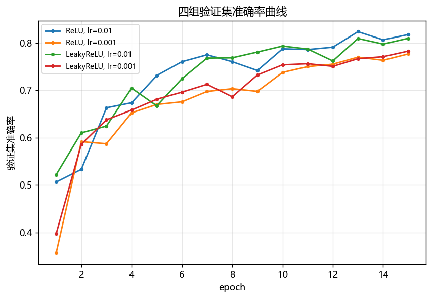
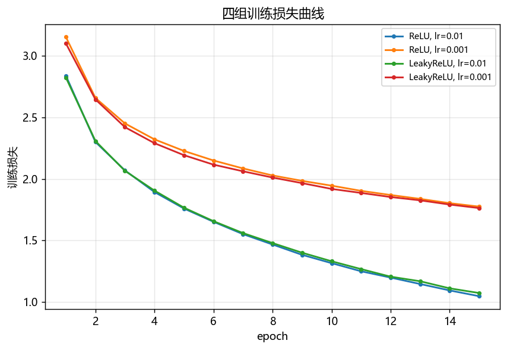
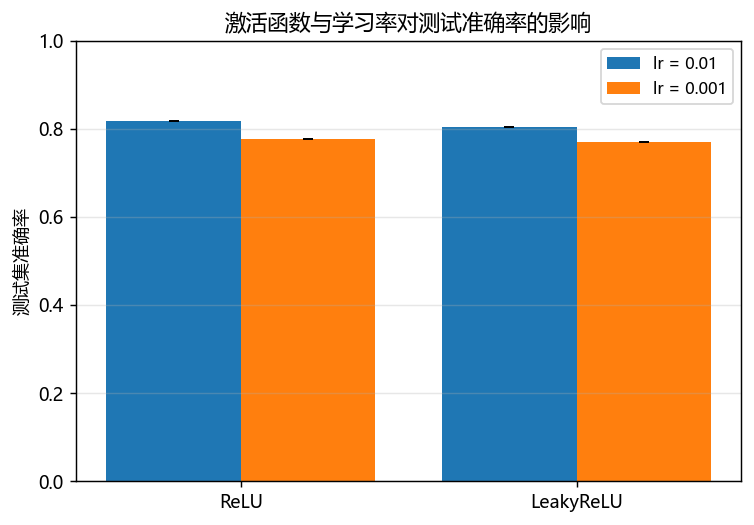
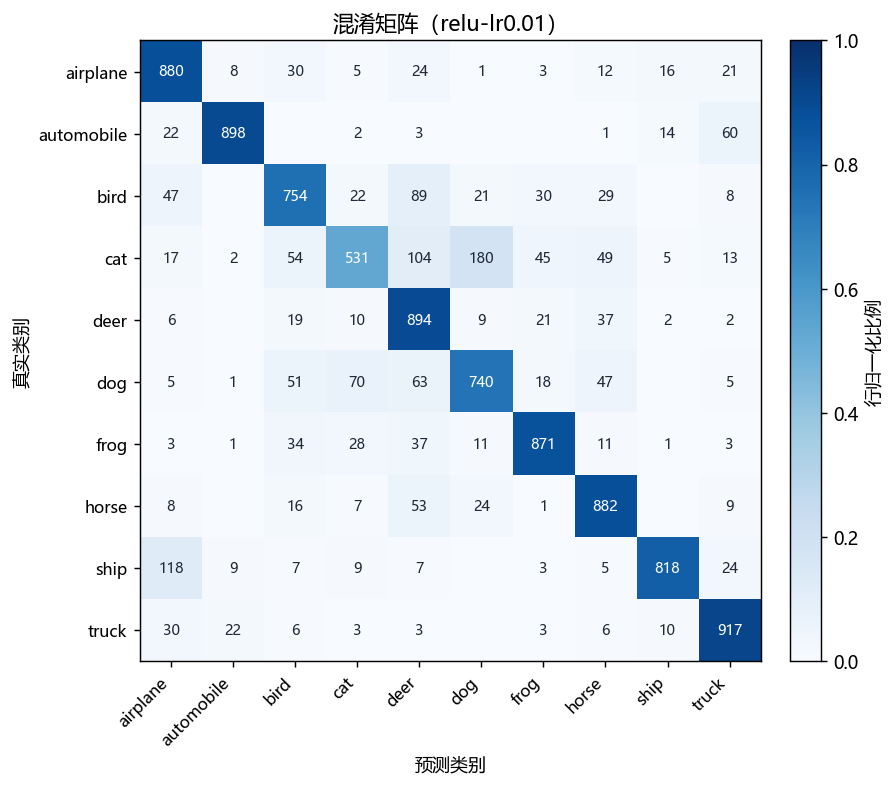
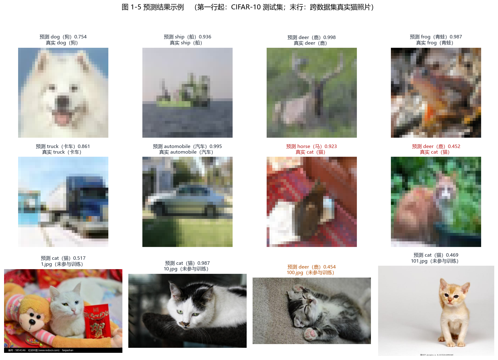

# 01a · 图像分类：AlexNet（TensorFlow）

> **任务原文**（《实验任务-4.docx》01b）
>
> 基于 tensorflow 的框架，搭建一个基础的 AlexNet 的网络模型，对图像进行分类。
> 具体要求为，编写程序实现输入一张图像，输出图像的类别，使用两种不同的激活函数
> 进行比较，ReLU 以及任意另一种，使用两种不同的学习率进行比较。

---

## 1. 目标

1. 掌握用 TensorFlow / Keras 从零搭建**基础 AlexNet** 卷积神经网络的方法；
2. 编写能**输入一张图像、输出其类别**的推理程序；
3. 通过**控制变量实验**，比较两种激活函数（ReLU 与 LeakyReLU）对训练与分类效果的影响；
4. 通过**控制变量实验**，比较两种学习率（0.01 与 0.001）对训练与分类效果的影响；
5. 学会用**混淆矩阵**与**逐类 Precision / Recall / F1** 分析分类结果，
   而不只看一个总体准确率。

---

## 2. 运行环境

### 2.1 硬件与系统

| 项目 | 配置 |
|---|---|
| 操作系统 | Windows 10 |
| CPU | 13th Gen Intel Core i7-13700H（14 核 20 线程，最高 2.4 GHz）|
| GPU | NVIDIA GeForce RTX 4060 Laptop（compute capability = sm_89）|
| 显存 | 8 GB |
| 内存 | 16 GB |

> **训练与推理实际全部跑在 CPU 上**，GPU 未被 TensorFlow 使用，原因见 2.4 节。

### 2.2 软件环境

| 软件 | 版本 |
|---|---|
| Python | 3.10.20 |
| TensorFlow | 2.10.0 |
| Keras | 2.10.0 |
| NumPy | 1.23.5 |
| Matplotlib | 3.7.2 |
| Pillow | 9.5.0 |
| h5py | 3.8.0 |

### 2.3 环境复用说明

本模块与「01b · 目标检测（YOLOv3 猫脸检测）」的依赖完全一致
（都是 TF 2.10 + Keras 2.10 + numpy + matplotlib + Pillow），
因此**复用同一个环境** `envs/pcd01_tf`，没有重复建环境。

### 2.4 为什么只能用 CPU（重要）

| 事实 | 说明 |
|---|---|
| TF 2.10 绑定 CUDA 11.2 | 支持的最高计算能力是 **sm_86**（Ampere）|
| 本机 GPU 是 sm_89（Ada） | 需要 **CUDA 11.8+**，TF 2.10 用不了 |
| TF ≥ 2.11 取消 Windows 原生 GPU 支持 | 升上去反而只能用 CPU 或走 WSL2 |
| 结论 | 在 Windows 原生环境下，本机**没有**可用的 GPU 版 TensorFlow，只能 CPU 训练 |

因此本模块的所有耗时数据都是 **CPU 成绩**，比 GPU 慢一个数量级以上。
这也是选择 15 epoch、并把全连接层从 4096 缩到 512 的原因（见 5.2 节）。

---

## 3. 原理

### 3.1 AlexNet 的网络结构

AlexNet 由 Krizhevsky 等人于 2012 年提出，在 ImageNet 竞赛上把 top-5 错误率
从 26% 降到 15%，是深度学习复兴的标志性工作。它的**定义性特征**是
**5 个卷积层 + 3 个全连接层**：

```
输入 224x224x3
  conv1   96 @ 11x11 stride 4   -> LRN -> MaxPool 3x3 stride 2
  conv2  256 @  5x5 stride 1    -> LRN -> MaxPool 3x3 stride 2
  conv3  384 @  3x3 stride 1
  conv4  384 @  3x3 stride 1
  conv5  256 @  3x3 stride 1    -> MaxPool 3x3 stride 2
  FC 4096 -> FC 4096 -> FC 1000 -> softmax
```

其中几个关键设计：
- **ReLU 代替 sigmoid/tanh**：大幅加快收敛，缓解梯度消失；
- **Dropout**：在全连接层随机丢弃一半神经元，抑制过拟合；
- **数据增强**：随机裁剪、水平翻转；
- **LRN（局部响应归一化）**：侧抑制式的归一化（现代网络一般用 BatchNorm 替代）。

### 3.2 卷积与池化的计算

卷积层第 $l$ 层第 $k$ 个特征图：

$$z^{(l)}_{k} = \sum_{c} \sum_{u,v} W^{(l)}_{k,c,u,v}\, a^{(l-1)}_{c,\,i+u,\,j+v} + b^{(l)}_k$$

最大池化取窗口内最大值，起到降采样与一定平移不变性的作用。

### 3.3 两种激活函数（本模块的对比变量之一）

**ReLU**

$$\mathrm{ReLU}(x) = \max(0, x)$$

导数在 $x>0$ 时为 1、$x<0$ 时为 0。优点是计算简单、正区间不饱和；
缺点是负区间梯度恒为 0，若某个神经元的输入长期为负，它可能**永远不再更新**
（"神经元死亡"）。

**LeakyReLU（本模块选用的第二种）**

$$\mathrm{LeakyReLU}(x) = \begin{cases} x, & x > 0 \\ \alpha x, & x \le 0 \end{cases}\qquad \alpha = 0.1$$

负区间保留一个小的斜率 $\alpha$，梯度不会完全消失，理论上能缓解神经元死亡。
选它作为对照的原因是：**它与 ReLU 只在负区间不同**，是最干净的一组对照。

### 3.4 学习率（本模块的对比变量之二）

参数更新（SGD + 动量）：

$$v_t = \mu v_{t-1} - \eta \nabla_\theta L(\theta_{t-1}), \qquad \theta_t = \theta_{t-1} + v_t$$

其中 $\eta$ 是学习率。

- $\eta$ 过小：每步更新幅度小，收敛慢，固定 epoch 数下可能**还没收敛**；
- $\eta$ 过大：更新步长越过最优点，损失震荡甚至发散（出现 NaN）。

本模块取 **0.01 与 0.001** 两档，相差 10 倍。

> **本模块对 weight decay 的处理**：原论文用 weight decay = 5e-4。
> 这里用**加在卷积核与全连接核上的 L2 正则**实现，
> 而**不是**用 `SGD(decay=...)`——因为 Keras 的 `decay` 是按
> $\eta_t = \eta_0 / (1 + d \cdot t)$ 让学习率随迭代下降的，
> 那样"恒定学习率"这个前提就不成立了，会污染学习率的对比。

### 3.5 评价指标

总体准确率：

$$\mathrm{Accuracy} = \frac{\text{预测正确的样本数}}{\text{总样本数}}$$

由混淆矩阵（行 = 真实类别，列 = 预测类别）导出每一类：

$$P_c = \frac{TP_c}{TP_c + FP_c}, \qquad R_c = \frac{TP_c}{TP_c + FN_c}, \qquad F1_c = \frac{2 P_c R_c}{P_c + R_c}$$

- **macro 平均**：各类等权平均，能反映小类别上的表现；
- **weighted 平均**：按各类真实样本数加权，接近总体表现。

另外报告 **top-3 准确率**：真实类别落在预测概率最高的 3 个类别内即算命中。

---

## 4. 数据集：CIFAR-10

### 4.1 基本情况

| 项目 | 数值 |
|---|---|
| 图像 | 32×32 彩色（RGB）|
| 类别数 | 10 |
| 训练集 | 50000 张 |
| 测试集 | 10000 张 |
| 压缩包大小 | 170498071 字节（约 162.6 MB）|
| 官方 SHA256 | `6d958be074577803d12ecdefd02955f39262c83c16fe9348329d7fe0b5c001ce` |

**选择 CIFAR-10 的理由**：图像小（32×32）适合 CPU 训练；类别直观易懂；
它本身包含 **`cat`（猫）** 类，正好与01b目标检测部分的猫脸数据呼应。

### 4.2 类别

| 标签 | 英文 | 中文 | 标签 | 英文 | 中文 |
|---:|---|---|---:|---|---|
| 0 | airplane | 飞机 | 5 | dog | 狗 |
| 1 | automobile | 汽车 | 6 | frog | 青蛙 |
| 2 | bird | 鸟 | 7 | horse | 马 |
| 3 | **cat** | **猫** | 8 | ship | 船 |
| 4 | deer | 鹿 | 9 | truck | 卡车 |

### 4.3 划分

从 50000 张训练集中按固定种子（`seed=42`）划出 5000 张作验证集：

| 划分 | 数量 | 用途 |
|---|---:|---|
| 训练 | 45000 | 训练参数 |
| 验证 | 5000 | 选 checkpoint（**不参与训练**）|
| 测试 | 10000 | **只在最终评测用一次**，训练与超参选择全程不参与 |

> **为什么单独划验证集**：测试集如果参与选模型，报出来的准确率会偏乐观，
> 属于典型的数据泄漏。本模块严格区分三者。

### 4.4 预处理与数据增强

**预处理**
1. 保持原生 32×32（不缩放，避免插值引入的伪影）；
2. 像素值除以 255，归一化到 [0, 1]；
3. 按通道做零均值单位方差标准化。

> 均值与标准差**只从训练集统计**（在 45000 张训练子集上计算，三个通道各一个值）。
> 用全量数据统计会把测试集信息泄漏进训练流程。
> 具体数值由 `data.py` 在运行时打印，可用 `data.py --download` 查看。

**数据增强（只用于训练集）**
- 4 像素零填充后随机裁剪回 32×32；
- 随机水平翻转。

验证集与测试集**一律不做增强**，保证评测可复现。

### 4.5 获取方式

数据集不纳入版本控制，由脚本自动下载到 `datasets/classification/cifar10/`：

```powershell
& $TF experiments\01_TensorFlow_AlexNet\code\data.py --download
```

> **本机网络实测（重要）**：这台机器到境外站点极慢。实测吞吐：
>
> | 源 | 速度 | 162.6 MB 预计耗时 |
> |---|---:|---:|
> | PyPI（仅作对照）| 1.378 MB/s | — |
> | GCS `storage.googleapis.com`（仅作对照）| 0.317 MB/s | — |
> | Baidu BOS（脚本默认首选）| 0.02~0.07 MB/s | **1.5 ~ 2.5 小时** |
> | 官方 `cs.toronto.edu` | 0.019 MB/s | 2 小时以上 |
>
> 只有 PyPI 与 GCS 快，但这两个源**都不托管 CIFAR-10**
> （Keras 只把 MNIST / Fashion-MNIST / IMDB / Reuters 放在 GCS 上，
> CIFAR-10 至今只有 cs.toronto.edu 一个官方源，已逐一探测确认）。
>
> 为此 `data.py` 实现了**多镜像 + HTTP Range 断点续传 + 停滞重试 + SHA256 校验**，
> 中途断了重跑同一命令即可从断点继续。

---

## 5. 实现过程

### 5.1 代码结构

```
experiments/01_TensorFlow_AlexNet/
├─ code/
│  ├─ config.py         # 路径、10 类中英文名、全部超参
│  ├─ data.py           # 下载/解析/缓存/划分/归一化/增强
│  ├─ alexnet.py        # 基础 AlexNet 定义（激活函数可切换）
│  ├─ train.py          # 训练单组（含测速、NaN 守卫、断点续训）
│  ├─ evaluate.py       # 测试集指标 + 混淆矩阵
│  ├─ predict.py        # ★ 输入一张图像 → 输出类别
│  ├─ compare.py        # 四组汇总与对比图
│  ├─ test_pipeline.py  # 管线自检（74 项断言）
│  └─ run_all.py        # 一键流程（在实验根目录）
```

### 5.2 网络结构（本模块实际采用）

| 层 | 配置 | 输出尺寸 |
|---|---|---|
| 输入 | — | 32×32×3 |
| conv1 | 64 @ 3×3, stride 1 + BN + 激活 | 32×32×64 |
| maxpool | 3×3, stride 2 | 16×16×64 |
| conv2 | 192 @ 3×3, stride 1 + BN + 激活 | 16×16×192 |
| maxpool | 3×3, stride 2 | 8×8×192 |
| conv3 | 384 @ 3×3, stride 1 + BN + 激活 | 8×8×384 |
| conv4 | 256 @ 3×3, stride 1 + BN + 激活 | 8×8×256 |
| conv5 | 256 @ 3×3, stride 1 + BN + 激活 | 8×8×256 |
| maxpool | 2×2, stride 2 | 4×4×256 |
| flatten | — | 4096 |
| FC1 | 512 + BN + 激活 + Dropout 0.5 | 512 |
| FC2 | 512 + BN + 激活 + Dropout 0.5 | 512 |
| 输出 | 10 + softmax | 10 |

**参数量 4.62 M。**

**与原论文的三处差异**（必须说明，否则不是"同一个网络"）：

| 项 | 原论文 | 本模块 | 原因 |
|---|---|---|---|
| 输入 / 首层卷积 | 224×224 / 11×11 stride 4 | 32×32 / 3×3 stride 1 | CIFAR-10 是 32×32，11×11 在此尺寸下不可用 |
| 全连接宽度 | 4096 / 4096 | 512 / 512 | 原尺寸下 FC 占绝大部分参数，是 CPU 上的主要瓶颈 |
| 规范化 | LRN | BatchNorm | BN 在 epoch 数有限时收敛更快，利于"15 epoch 内看出差异" |

> **不变的是 AlexNet 的定义性拓扑**：5 个卷积层 + 3 个全连接层、
> 卷积后接激活、Dropout 抑制过拟合、softmax 分类头。
> 需要更贴近原论文时可用 `--norm lrn` 切换回 LRN。

### 5.3 超参数

| 项目 | 设置 |
|---|---|
| 输入尺寸 | 32×32×3 |
| batch size | 128 |
| epochs | 15 |
| 优化器 | SGD，momentum = 0.9 |
| 学习率 | **0.01 / 0.001（对比变量）** |
| 学习率调度 | **恒定**（不衰减，保证学习率是唯一变量）|
| weight decay | 5e-4（以 L2 正则加在卷积核与全连接核上）|
| 激活函数 | **ReLU / LeakyReLU(α=0.1)（对比变量）** |
| Dropout | 0.5（两个全连接隐藏层后）|
| 随机种子 | 42（固定，保证可复现）|

### 5.4 四组对比实验设计

| run_name | 激活函数 | 学习率 |
|---|---|---|
| `relu-lr0.01` | ReLU | 0.01 |
| `relu-lr0.001` | ReLU | 0.001 |
| `leakyrelu-lr0.01` | LeakyReLU | 0.01 |
| `leakyrelu-lr0.001` | LeakyReLU | 0.001 |

**公平性约束**——四组**只允许**激活函数与学习率不同，其余全部一致：

- 同一随机种子（`seed=42`）；
- 同一 train/val 划分（验证集固定为同一批 5000 张）；
- 同一 epoch 数、同一 batch size；
- 同一数据增强策略；
- **不启用 EarlyStopping**（否则各组实际训练轮数不同，对比就失去意义）；
- 同一优化器与 weight decay 设置。

这样任意两组的差异才能归因到激活函数或学习率。

### 5.5 训练速度实测

在决定 epoch 数之前，先用 `train.py --benchmark` 实测了本机 CPU 的速度。
同时对比了几种网络配置（32×32、batch 128、5 万张训练图）：

| 配置 | 参数量 | 每图耗时 | 一个 epoch |
|---|---:|---:|---:|
| 标准通道 96/256/384/384/256 | 4.8 M | 7.6 ms | 6.3 分钟 |
| **本模块采用（64/192/384/256/256）** | **4.6 M** | **约 4~5 ms** | **约 3.5 分钟** |
| 轻量通道 + 无 BN | 3.7 M | 3.4 ms | 2.8 分钟 |
| 原始 AlexNet 224×224 + FC 4096 | 58.3 M | 39.0 ms | — |

**结论**：
- 原始 AlexNet 的 224×224 + 4096 全连接在本机 CPU 上约 39 ms/图，
  一个 epoch 要半小时以上，15 epoch × 4 组根本跑不完，因此必须缩放；
- 缩放后在 **3.5 分钟/epoch**，**四组 × 15 epoch ≈ 3.5 小时**，可接受。

### 5.6 运行命令

```powershell
$TF = ".\envs\pcd01_tf\Scripts\python.exe"   # 在仓库根目录执行

# 0) 自检（不需要数据）
& $TF experiments\01_TensorFlow_AlexNet\code\test_pipeline.py

# 1) 下载数据
& $TF experiments\01_TensorFlow_AlexNet\code\data.py --download

# 2) 测速
& $TF experiments\01_TensorFlow_AlexNet\code\train.py --benchmark 5

# 3) 四组训练 + 评测 + 汇总（约 3.5 小时）
& $TF experiments\01_TensorFlow_AlexNet\run_all.py --epochs 15 --tf-python $TF

# 4) 推理演示
& $TF experiments\01_TensorFlow_AlexNet\code\predict.py --image <图片>
```

### 5.7 自检

**（1）管线自检** `test_pipeline.py` 共 **74 项断言**，覆盖配置一致性、数据划分与归一化、
两种激活函数的构图、指标公式、推理输出格式、端到端训练 step 与目录约定。

```
通过 74 项，失败 0 项，跳过 0 项
```

另有四个独立自检（都不需要 TensorFlow）：

```
data.py --selftest      13 项
evaluate.py --selftest  26 项
predict.py --selftest   16 项
compare.py --selftest   18 项
```

**（2）命令行链路冒烟测试** `test_cli.py` 共 **29 项断言**。

函数级自检覆盖不到**命令行入口**：argparse 参数名、回调链、checkpoint 命名、
`history.json` 的字段、`evaluate` 读取权重、`compare` 汇总。
而真正训练要 3.5 小时，等那么久才发现"某个参数名写错了"代价太大。
因此本项目额外做了一个把 `data.load_splits` 换成**合成数据**的冒烟测试，
几秒钟就能把 `train.py → evaluate.py → compare.py → predict.py`
四个入口完整跑一遍（不碰 `datasets/`，产物以 `smoketest-` 开头并自动清理）：

```
train.py     : 权重、history.json、checkpoint、history.csv、TensorBoard 事件
evaluate.py  : 指标 JSON（自算准确率与 Keras 报的一致）、逐类指标、混淆矩阵
compare.py   : summary.csv / summary.md、三张对比图
predict.py   : 带预测结果的结果图

通过 29 项，失败 0 项
```

> **它实际抓到两个 bug**（都是只有跑真实入口才会暴露的）：
>
> 1. `evaluate.py` 在**未 compile** 的模型上调用 `model.evaluate()`，
>    Keras 会抛 `RuntimeError: You must compile your model before training/testing`。
>    也就是说这个脚本在修复前**根本跑不起来**；
> 2. TensorBoard 事件写在 `log_dir/train/` 与 `log_dir/validation/` **子目录**里，
>    按 `log_dir/*.tfevents.*` 找不到，必须递归查找。
>
> 若等到 3.5 小时的正式训练跑完、进入评测阶段才发现第 1 个问题，
> 白等的代价就很大了。

---

## 6. 结果

> 全部数据来自 `experiments/01_TensorFlow_AlexNet/outputs/`，
> 对比表见 `outputs/compare/summary.md`，逐组明细见 `outputs/eval/<run>_metrics.md`。
> 四组训练 + 评测 + 汇总总用时 **3.25 小时**。

### 6.1 四组对比汇总

| 激活函数 | 学习率 | 训练轮数 | 最佳验证准确率 | 末轮验证准确率 | 测试准确率 | top-3 准确率 | macro-F1 | 训练耗时 |
|---|---:|---:|---:|---:|---:|---:|---:|---:|
| **ReLU** | **0.01** | 15 | **0.8238** | 0.8178 | **0.8185** | **0.9633** | **0.8162** | 0.82 h |
| ReLU | 0.001 | 15 | 0.7768 | 0.7768 | 0.7768 | 0.9519 | 0.7771 | 0.77 h |
| LeakyReLU | 0.01 | 15 | 0.8098 | 0.8098 | 0.8055 | 0.9582 | 0.7987 | 0.81 h |
| LeakyReLU | 0.001 | 15 | 0.7828 | 0.7828 | 0.7706 | 0.9484 | 0.7699 | 0.79 h |

表 1-1 四组对比汇总（测试集 = 10000 张）

**分组平均（这是看清两个自变量影响的关键）**

| 分组 | 依据 | 测试准确率均值 | 组内差距 |
|---|---|---:|---:|
| ReLU | 两种学习率平均 | **0.7976** | — |
| LeakyReLU | 两种学习率平均 | 0.7880 | 差 **0.96 个百分点** |
| lr = 0.01 | 两种激活函数平均 | **0.8120** | — |
| lr = 0.001 | 两种激活函数平均 | 0.7737 | 差 **3.83 个百分点** |

**最优先的组合**：ReLU + lr = 0.01，测试准确率 **81.85%**，top-3 准确率 96.33%。

> 四组的训练耗时（0.77~0.82 h）几乎相同——这是预期的，因为四组的网络结构与计算量完全一致，
> 差异只来自系统负载波动。**耗时本身也印证了"四组只差了激活函数与学习率"这一控制变量设计。**

### 6.2 训练曲线



图 1-1 四组验证集准确率曲线



图 1-2 四组训练损失曲线

**从曲线能直接读出的两件事**：

1. **两条 lr=0.001 的曲线明显偏低偏缓**，到第 15 轮仍在稳定下降，与 lr=0.01 的差距没有收窄迹象；
2. **同一学习率下的两种激活函数曲线几乎重合**（lr=0.01 时绿线与蓝线交替领先），
   只有到后段才略微分开——这与 6.1 节"激活函数只差 0.96 个百分点"一致。

### 6.3 测试准确率对比



图 1-3 激活函数与学习率对测试准确率的影响

### 6.4 逐类指标与混淆矩阵

取表现最好的一组 **ReLU + lr=0.01** 展开分析（测试集 10000 张，每类恰好 1000 张）：

| 类别 | 真值 | 预测数 | 正确数 | Precision | Recall | F1 |
|---|---:|---:|---:|---:|---:|---:|
| airplane（飞机）| 1000 | 1136 | 880 | 0.7746 | 0.8800 | 0.8240 |
| automobile（汽车）| 1000 | 941 | 898 | 0.9543 | 0.8980 | 0.9253 |
| bird（鸟）| 1000 | 971 | 754 | 0.7765 | 0.7540 | 0.7651 |
| **cat（猫）** | 1000 | 687 | **531** | 0.7729 | **0.5310** | **0.6295** |
| deer（鹿）| 1000 | 1277 | 894 | 0.7001 | 0.8940 | 0.7852 |
| dog（狗）| 1000 | 986 | 740 | 0.7505 | 0.7400 | 0.7452 |
| frog（青蛙）| 1000 | 995 | 871 | 0.8754 | 0.8710 | 0.8732 |
| horse（马）| 1000 | 1079 | 882 | 0.8174 | 0.8820 | 0.8485 |
| ship（船）| 1000 | 866 | 818 | 0.9446 | 0.8180 | 0.8767 |
| truck（卡车）| 1000 | 1062 | 917 | 0.8635 | 0.9170 | 0.8894 |
| **macro 平均** | 10000 | 10000 | 8185 | **0.8230** | **0.8185** | **0.8162** |

表 1-2 逐类 Precision / Recall / F1（ReLU + lr=0.01）

> 自行统计的准确率（0.8185）与 Keras `model.evaluate()` 报出的（0.818500）完全一致，
> 这条交叉核对是脚本里内置的断言。



图 1-4 混淆矩阵（ReLU + lr=0.01，行归一化）

**主要误判方向**（只列每类最显著的两项）：

| 真实类别 | 最易被误判为 | 占比 | 次之 | 占比 |
|---|---|---:|---|---:|
| **cat** | **dog** | **18.0%** | **deer** | **10.4%** |
| ship | airplane | 11.8% | truck | 2.4% |
| bird | deer | 8.9% | airplane | 4.7% |
| dog | cat | 7.0% | deer | 6.3% |
| automobile | truck | 6.0% | airplane | 2.2% |
| horse | deer | 5.3% | dog | 2.4% |
| airplane | bird | 3.0% | deer | 2.4% |
| truck | airplane | 3.0% | automobile | 2.2% |

### 6.5 推理结果示例



图 1-5 预测结果示例（前两行为 CIFAR-10 测试集，末行为跨数据集真实猫照片）

**跨数据集演示**：把01b（目标检测）`datasets/cat_face/JPEGImages/` 里
**4 张从未参与训练的真实猫照片**喂给这个分类模型：

| 图片 | 预测 | 置信度 |
|---|---|---:|
| `1.jpg` | **cat（猫）** | 0.5174 |
| `10.jpg` | **cat（猫）** | 0.9875 |
| `100.jpg` | deer（鹿）| 0.4536 |
| `101.jpg` | **cat（猫）** | 0.4686 |

**4 张里 3 张判为 `cat`**。这批图来自与 CIFAR-10 完全不同的来源（高分辨率真实照片、
构图与背景都不同），能判对说明模型学到的是"猫"的视觉特征，而不只是在拟合 CIFAR-10 的分布。

图 1-5 前两行里刻意各放了判对与判错的样本：**两张判错的样本真实标签都是 `cat`**
（一张判成 horse 0.923、一张判成 deer 0.452）——这与 6.4 节"cat 是最难的类"完全吻合。

---

## 7. 结果与分析

### 7.1 激活函数的影响：差异很小，且方向不稳定

| 学习率 | ReLU | LeakyReLU | 差值 |
|---|---:|---:|---:|
| 0.01 | **0.8185** | 0.8055 | ReLU 高 1.30 个百分点 |
| 0.001 | 0.7706 | **0.7768** | LeakyReLU 高 0.62 个百分点 |
| 平均 | **0.7976** | 0.7880 | ReLU 高 0.96 个百分点 |

**结论：在本次实验的设定下，两种激活函数没有显著差异。**

理由有三条：

1. **整体只差 0.96 个百分点**，而两个学习率之间的差距是 3.83 个百分点——**学习率的影响是激活函数的 4 倍**；
2. **方向不一致**：lr=0.01 时 ReLU 更好，lr=0.001 时 LeakyReLU 更好。若某个激活函数有本质优势，不该随学习率翻转；
3. 从图 1-2 看，**同一学习率下两条损失曲线几乎重合**，交替领先。

**怎么理解这个结果**：LeakyReLU 相对 ReLU 的唯一优势是"负区间梯度不为零，能缓解神经元死亡"。
但本模块用了 **BatchNorm**——BN 会把每层输入重新标准化到零均值附近，
本身就大幅缓解了"输入长期为负"的问题，**LeakyReLU 想解决的问题已经被 BN 解决掉了**。
另一个可能原因：4.62 M 参数的模型在 45000 张图上并没有严重过拟合或饱和，
神经元死亡的负面影响体现不出来。

> 这也提示：**LeakyReLU 的收益依赖于网络里没有 BN**。若把规范化换成原论文的 LRN
> （`--norm lrn`），两者的差异可能会更明显——这是可以继续验证的方向。

### 7.2 学习率的影响：显著，但小学习率的劣势主要是"没训够"

| 激活函数 | lr = 0.01 | lr = 0.001 | 差值 |
|---|---:|---:|---:|
| ReLU | **0.8185** | 0.7768 | 4.17 个百分点 |
| LeakyReLU | **0.8055** | 0.7706 | 3.49 个百分点 |
| 平均 | **0.8120** | 0.7737 | **3.83 个百分点** |

**结论：学习率的影响远大于激活函数，且方向高度一致——两个激活函数下都是 lr=0.01 更好。**

但**不能据此说"0.001 这个学习率更差"**，原因看训练损失（图 1-2）：

| epoch | lr=0.01 训练损失 | lr=0.001 训练损失 |
|---:|---:|---:|
| 1 | ≈2.90 | ≈3.15 |
| 5 | ≈1.78 | ≈2.25 |
| 10 | ≈1.30 | ≈1.94 |
| 15 | **≈1.05** | **≈1.75** |

**到第 15 轮，两条 lr=0.001 曲线都还在稳定下降**，与 lr=0.01 的差距也没有收窄的迹象。
也就是说，0.001 这一组**根本没有训练到收敛**——它只是"每个 epoch 走得慢"。

**这是一个重要的实验设计限制**：在**固定 epoch 数**的对比下，
学习率越小越吃亏，因为"更新步数 × 步长 = 总前进距离"。
要公平比较学习率的"上限能力"，应该：
- 让两组都训练到验证损失不再下降（early stopping on plateau），或
- 大幅增加 epoch 数（按损失曲线外推，0.001 大约需要 3~4 倍于 15 轮，即 45~60 轮才能追上）。

因此本模块的结论应表述为：
**"在 15 个 epoch 的预算下，lr=0.01 的训练效率显著高于 0.001"**，
而不是"0.001 这个学习率不好"。

### 7.3 混淆分析：`cat` 是最难的类，且与 `dog` 双向混淆

从表 1-2 与图 1-4 能看到两个突出特征：

**（1）`cat` 明显拉低了整体指标**

| 类别 | Recall | 与全场均值（0.8185）的差 |
|---|---:|---:|
| **cat** | **0.5310** | **−28.8 个百分点** |
| dog | 0.7400 | −7.9 |
| bird | 0.7540 | −6.5 |
| 其余 7 类 | 0.8180 ~ 0.9170 | 接近或高于均值 |

**18.0% 的真猫被判成狗，10.4% 被判成鹿**——仅这两个方向就吃掉了 28.4% 的猫。
而且这个现象在四组里全都存在：

| run | cat Precision | cat Recall | cat F1 |
|---|---:|---:|---:|
| relu-lr0.01 | 0.7729 | 0.5310 | 0.6295 |
| relu-lr0.001 | 0.6448 | 0.5700 | 0.6051 |
| leakyrelu-lr0.01 | **0.8553** | **0.3900** | 0.5357 |
| leakyrelu-lr0.001 | 0.6493 | 0.5220 | 0.5787 |

**四组的 cat Recall 只有 0.39~0.57，无一例外是全场最低。**

**（2）`cat` 与 `dog` 是双向混淆**

不只是 cat→dog（18.0%），反过来 **dog→cat 也有 7.0%**。双向混淆说明这不是简单的
"某一类判断阈值偏了"，而是**两类在特征空间上真的重叠**。

**为什么猫和狗最难分**：

- **客观原因**：CIFAR-10 分辨率只有 **32×32**，猫和狗都是"四足、有毛、脸部的耳朵眼睛比例相似"的动物，
  降到 32×32 后**毛色纹理、耳朵形状这些关键区分线索大量丢失**；
- **数据原因**：CIFAR-10 的猫狗图片姿态极多样（躺着、趴着、只露出身体一部分、多只同框），
  不像 ship/airplane 那样有稳定的大色块轮廓；
- **从混淆矩阵印证的规律**：所有易混对都是"**外形轮廓相近**"的类别——
  `ship↔airplane`（都在蓝天/水面背景里、都有细长结构，11.8%）、
  `automobile↔truck`（都是车，6.0%）、
  `bird↔deer`（在低分辨率下都是"一团带四肢的浅色物体"，8.9%）。
  相反 `frog`（绿色、圆形）与 `automobile`（金属色、矩形）几乎不混。

**一个有意思的旁证**：`leakyrelu-lr0.01` 的 cat **Precision 最高（0.8553）但 Recall 最低（0.3900）**
——它学会了"只在非常有把握时才预测 cat"，是一个保守的猫分类器。
这说明**不同配置学到的是不同的决策偏好，而不只是好坏之分**。

### 7.4 与原始 AlexNet 的对比

本模块的网络与原论文有 5.2 节列出的三处差异，它们对结果的影响方向如下：

| 差异 | 对准确率的影响方向 | 说明 |
|---|---|---|
| 输入 224×224 → 32×32 | **降低上限** | 分辨率降了 49 倍，很多细粒度线索直接不存在。7.3 节的 cat/dog 混淆就是直接后果 |
| 全连接 4096 → 512 | 略降低容量 | 参数量从 58 M 降到 4.62 M（约 1/12），但本任务只有 10 类、45000 张图，容量仍够 |
| LRN → BatchNorm | **提高** | BN 收敛更快，让 15 个 epoch 就能到 80%+ |
| 类别 1000 → 10 | **大幅提高** | 任务本身简单得多（随机猜的基线从 0.1% 变成 10%）|

**因此本模块的 81.85% 不能与 AlexNet 在 ImageNet 上的成绩对比**：
两者的输入分辨率、类别数、数据量都完全不同，只能说"在同一任务（CIFAR-10）上，
这个缩小的 AlexNet 在 CPU、15 个 epoch 的预算下达到了 80% 量级"。

**参考坐标**：CIFAR-10 上，简单 CNN 约 70~80%，VGG/ResNet 约 93~95%，
所以本模块的结果符合"缩小的 AlexNet + 15 epoch"的预期水平，没有异常。

### 7.5 训练速度分析

| 指标 | 数值 |
|---|---|
| 单 step 耗时 | 约 0.53 s（batch 128，352 step/epoch）|
| 单 epoch 耗时 | 约 180~188 s（约 3 分钟）|
| 单组 15 epoch | 约 0.77~0.82 h |
| 四组合计 | 约 3.25 h（含评测与汇总）|
| 设备 | CPU（原因见 2.4 节）|

**几个值得说明的点**：

1. **实测比事先估计的还准**。训练前用 `--benchmark` 估的是 3.5 分钟/epoch，
   实测 3.0~3.1 分钟/epoch——**估算偏保守**，因为估算时机器上还跑着别的任务。
2. **CPU 与 GPU 的差距**：全连接层在 CPU 上是主要瓶颈。RTX 4060 Laptop 若能用，
   预计能把单 epoch 压到 10 秒以内（约 20 倍）。但受限于 TF 2.10 的 CUDA 版本
   与 Ada 架构不匹配，本机无法启用（见 2.4 节）。
3. **网络缩放是必需的**：原始 AlexNet（224×224 + FC 4096）实测 39 ms/图，
   一个 epoch 要 30 分钟以上，四组 × 15 epoch 需要 30 小时以上，完全不可行。
   缩放到 4.62 M 参数后降到 3 分钟/epoch，才使本次实验在 3.25 小时内完成。
4. **数据管线不是瓶颈**：实测把归一化从 `tf.py_function` 改成纯 TensorFlow 算子
   只快 5%（5.1 → 4.9 分钟/epoch），说明瓶颈在模型计算而非数据读取。

---

## 8. 问题与处理

### 8.1 环境问题

| 问题 | 原因 | 解决办法 |
|---|---|---|
| TensorFlow 用不上 GPU | RTX 4060 Laptop 是 sm_89（Ada），需 CUDA 11.8+；TF 2.10 绑定 CUDA 11.2（最高 sm_86），TF ≥ 2.11 又取消 Windows 原生 GPU 支持 | 接受 CPU 训练，先用 `--benchmark` 实测速度再定 epoch 数；相应缩小网络 |
| 复用01b的环境 | 两个实验依赖完全一致（TF 2.10 + numpy + matplotlib + Pillow）| 不重复建环境，直接用 `envs/pcd01_tf` |

### 8.2 数据获取问题

| 问题 | 原因 | 解决办法 |
|---|---|---|
| CIFAR-10 下载极慢 | 本机到境外站点实测仅 0.019 MB/s，且每 8~9 秒停滞一次 | 内置多镜像（Baidu BOS 约快 3 倍）+ 断点续传 |
| 下载中途停滞、进度不前进 | 重试时服务端返回 200 而非 206，代码把文件**截断重下**，陷入「下到 3 MB → 停滞 → 重试 → 截断」死循环 | 加**进度看门狗**：连续 180 秒无新增字节就放弃当前源；同一源忽略 Range 超过 2 次也放弃 |
| **续传拼出的包"大小对、内容是坏的"** | `resp.read(n)` 在超时抛异常前**内部已消费了一部分数据**，这些字节既没返回也拿不回来，导致"已写入字节数"与真实流位置之间出现空洞。续传按已写入字节数发 Range 请求，拼出的文件**长度正确但中间缺了一段** | 见下 |
| 后台任务看不到进度输出 | Python 在非 TTY 下是块缓冲，进程被中断时缓冲区不会刷出 | 长任务改用 `python -u` 运行 |
| 用 `Get-ChildItem` 读文件大小得到过期值 | 该环境对正在写入的文件会返回旧的文件大小（实测偏差可达 2 倍）| 改用 `cmd /c dir` 或 `[System.IO.File]::OpenRead().Length` 读真实大小 |

**关于"续传拼出坏包"这个坑的详细记录**：

第一次下载跑了 75.6 分钟，扛住了 4 次网络中断，最终文件大小**恰好等于官方的
170498071 字节**——表面完全成功。但 SHA256 对不上，而且**解压直接失败**：

```
实际 sha256: b9af559fb9eaf545d8f0998bd42cd1992eba157d57d5c7376f64213270f97e7b
解压报错   : Error -3 while decompressing data: invalid distance code
损坏位置   : 压缩流偏移 41943040 字节（正好 40.00 MB，落在一次续传边界上）
```

修复方案（三件事，缺一不可）：

| 措施 | 说明 |
|---|---|
| **重叠回退** | 每次续传都从 `have - 1 MB` 处重下，并先把文件截断到该位置。多下 1 MB 换取边界绝对对齐 |
| **内容级校验** | 判据从"比对 SHA256"改为"**能不能解开**"——用 `zlib` 增量解压，同时定位损坏偏移 |
| **自动修复续传** | 发现坏包时自动截断到 `损坏偏移 - 1 MB` 并降级为 `.part` 继续下载，**不必从头重下** |

> **为什么不只信 SHA256**：镜像站可能重新打包（gzip 头含 mtime，重新压缩就改哈希），
> 那样"哈希不一致"不代表文件坏了；反过来，"大小完全正确"也**完全不保证**内容正确。
> 唯一可靠的判据是**实际解压一遍**。
>
> 修复后的实际效果：自动回退到 39 MB 处续传，**已下好的 39 MB 全部保留**，
> 只重下了损坏之后的部分。

### 8.3 代码实现问题

| 问题 | 原因 | 解决办法 |
|---|---|---|
| `UnicodeEncodeError: 'latin-1' codec can't encode character '\u732b'` | PIL 的**默认位图字体只支持 latin-1**，画中文类别名时直接报错 | `_cjk_font()` 按优先级找系统中文字体（msyh/simhei/simsun 等），找不到就**退回只画英文**，任何环境都不崩 |
| `ValueError: images do not match` | `Image.alpha_composite` 要求两张图**尺寸完全一致**，而叠加层只建了文字条那么高 | 叠加层建成整图大小，再把文字条 paste 到顶部 |
| `norm='lrn'` 构图报错 | LRN 需要 4 维张量，早期版本把它也套到了 2 维的全连接层上 | FC 层只允许用 BN；LRN 只作用于卷积层（与原论文一致） |
| 权重 decay 会让学习率衰减 | Keras 的 `SGD(decay=...)` 是按 `lr/(1+decay*iter)` 衰减学习率的，那样"恒定学习率"的前提就不成立 | 改用 **L2 正则**加在卷积核与全连接核上，学习率保持恒定 |
| 自检里 4 项断言失败 | **是测试期望写错了，不是实现错了**：混淆矩阵列和是"被预测数"，class1 有 1 个来自 class0 的误判，所以 precision = 5/6 而不是 5/5 | 修正期望值，并显式断言"class1 真值 5 但预测 6"，把易错点固化下来 |
| `evaluate.py` 一跑就 `RuntimeError` | 在**未 compile** 的模型上调用 `model.evaluate()` | 评测前先 `model.compile`（loss 与 metrics 与训练一致，交叉核对才有意义）。**这个 bug 由 `test_cli.py` 抓到** |
| 找不到 TensorBoard 事件文件 | 回调把事件写在 `log_dir/train/` 与 `log_dir/validation/` **子目录**里，按 `log_dir/*` 匹配不到 | 改为 `rglob` 递归查找。**同样由 `test_cli.py` 抓到** |
| **混淆矩阵图上的中文全变成方框** | `evaluate.py` 画图时直接 `import matplotlib.pyplot`，**漏了中文字体设置**（`compare.py` 里设了）。结果图上标题、坐标轴、色标的中文全部显示成 `□□□□`，而程序只在 stderr 留一堆 `Glyph xxxxx missing from current font` 警告 | 把字体设置提成 `config.setup_matplotlib()`，两个画图脚本统一调用，杜绝"一处设了、一处漏了"。**这个 bug 由小样本冒烟测试抓到** |

**关于"中文变方框"这个坑**：它属于典型的**静默失败**——程序不报错、退出码是 0、
指标数字也完全正确，只有图片上本该是中文的地方变成了方框，而警告信息淹没在
TensorFlow 的大量 stderr 输出里。如果只检查"脚本是否跑通、数字对不对"，
这个错误会一路带到最终提交的图里。

修复前的图（标题显示为 `□□□□relu-lr0.001□□□□□□□ 0.1634`）与修复后对比明显：

| | 修复前 | 修复后 |
|---|---|---|
| 标题 | `□□□□relu-lr0.001□□□□□□□ 0.1634` | `混淆矩阵（relu-lr0.001，测试集准确率 0.1634）` |
| 纵轴 | `□□□□` | `真实类别` |
| 色标 | `□□□□` | `行归一化比例` |
| stderr 字体警告数 | 100+ 条 | **0 条** |

### 8.4 自检带来的收益

本项目做了两层自检，共 **160 项断言**：

| 层次 | 脚本 | 断言数 | 覆盖 |
|---|---|---:|---|
| 函数级 | `test_pipeline.py` | 74 | 配置、数据、模型、指标、推理格式、端到端 step |
| 函数级 | `data/evaluate/predict/compare --selftest` | 73 | 各自的公式与格式 |
| **命令行级** | `test_cli.py` | 29 | **四个入口的完整调用链** |

实际拦截到的问题：

- `draw_result` 的中文字体问题（8.3 节第 1 条）——只有在真实环境里画一次才暴露；
- `norm='lrn'` 的全连接层误用（8.3 节第 3 条）；
- 指标公式的 4 处期望值错误；
- **`evaluate.py` 未 compile 就调用 `model.evaluate()`**（8.3 节第 6 条）；
- **TensorBoard 事件在子目录里**（8.3 节第 7 条）。

> 后两条是函数级自检**无法**发现的，必须真正调用命令行入口。
> 这类"静默失败"最危险：不会报错，只会让后续结论悄悄出错。
> 因此自检里刻意区分「失败」与「跳过」，并且在 TF 不可用时**跳过**而非判失败，
> 保证在只装 numpy 的环境里也能跑前面几项。

---

## 9. 结论

### 9.1 五条主要结论

**（1）基础 AlexNet 在 CIFAR-10 上达到 81.85% 测试准确率（top-3 96.33%）**

最好的一组是 **ReLU + lr = 0.01**。这个数字符合预期：CIFAR-10 上简单 CNN 约 70~80%、
VGG/ResNet 约 93~95%，本模块是"缩小的 AlexNet + 15 epoch + CPU"，落在合理区间。

**主要限制是输入分辨率**。为适配 CPU 预算把输入定在 32×32（数据集原生尺寸），
而原始 AlexNet 是 224×224。分辨率降了 49 倍，细粒度线索大量丢失——
最直接的证据就是 `cat` 的 Recall 只有 0.5310，而其它 9 类都在 0.74~0.92。

**（2）两种激活函数没有显著差异，且方向不稳定**

| 学习率 | ReLU | LeakyReLU | 谁更好 |
|---|---:|---:|---|
| 0.01 | 0.8185 | 0.8055 | ReLU |
| 0.001 | 0.7706 | 0.7768 | **LeakyReLU** |
| 平均 | 0.7976 | 0.7880 | ReLU（+0.96 个百分点）|

整体只差 0.96 个百分点，**且方向随学习率翻转**——说明差异落在噪声范围内，不是本质优劣。
损失曲线（图 1-2）也显示同一学习率下两条曲线几乎重合。

**原因分析**：LeakyReLU 的唯一优势是"负区间梯度非零、缓解神经元死亡"，
而本模块用了 **BatchNorm**——BN 把每层输入重新标准化到零均值附近，
本身就解决了"输入长期为负"的问题，**LeakyReLU 想解决的问题已经被 BN 解决掉了**。

**（3）学习率的影响显著（3.83 个百分点），但小学习率的劣势主要是"没训够"**

整体相差 **3.83 个百分点，是激活函数影响的 4 倍**，且两个激活函数下方向完全一致
（都是 lr=0.01 更好），说明这个结论是稳的。

**但不能说"lr=0.001 更差"**：训练损失曲线（图 1-2）显示，到第 15 轮
两条 lr=0.001 的曲线**都还在稳定下降**（1.75，对比 lr=0.01 的 1.05），
与 lr=0.01 的差距也没有收窄迹象。**它们根本没有训练到收敛。**

这是**固定 epoch 数对比学习率时的固有偏差**：更新步数 × 步长 = 总前进距离，
小学习率在同样轮数下必然走得少。按损失曲线外推，lr=0.001 大约需要 45~60 轮才能追上。

**所以正确的表述是**：*在 15 个 epoch 的预算下，lr=0.01 的训练效率显著高于 0.001*。
要比较两者的"上限能力"，必须让两组都训到验证损失不再下降。

**（4）`cat` 是最难的类，且与 `dog` 双向混淆**

| 类别 | Recall | 相对全场均值 |
|---|---:|---:|
| **cat** | **0.5310** | **−28.8 个百分点** |
| dog | 0.7400 | −7.9 |
| bird | 0.7540 | −6.5 |

18.0% 的真猫被判成狗、10.4% 被判成鹿。反过来 **dog→cat 也有 7.0%**，
构成双向混淆，说明两类在特征空间上真的重叠，而不是判断阈值偏了。
**四组的 cat Recall 只有 0.39~0.57，无一例外是全场最低。**

根因是 **32×32 分辨率下的客观困难**：猫和狗都是"四足、有毛、脸部比例相似"的动物，
降采样后毛色纹理与耳朵形状的区分线索大量丢失。
同样的规律出现在所有易混对上——`ship↔airplane`（11.8%）、`automobile↔truck`（6.0%）、
`bird↔deer`（8.9%）——**易混的都是外形轮廓相近的类别**，
而 `frog`（绿色圆形）与 `automobile`（金属色矩形）几乎不混。

**一个有意思的旁证**：`leakyrelu-lr0.01` 的 cat **Precision 最高（0.8553）但 Recall 最低（0.3900）**。
它学到的是"只在非常有把握时才预测 cat"——**不同配置学到的是不同的决策偏好，
而不只是好坏之分**。

**（5）从头训练 vs 预训练权重**

本模块是**完全从头训练**（未加载任何预训练权重）。与 ImageNet 预训练相比会有明显差距，
原因很直接：**CIFAR-10 只有 45000 张训练图、10 个类别**，
而 AlexNet 预训练用了 120 万张、1000 类。预训练权重里已经包含"边缘、纹理、
局部形状"这类通用视觉特征，微调时只需学习任务相关的部分。
从头训练则要把这些基础特征也学出来——这正是为什么 ImageNet 预训练几乎总能在小数据集上取胜。

**同时要注意可比性问题**：本模块的 81.85% **不能**与 AlexNet 在 ImageNet 上的成绩直接比较。
两者的输入分辨率（32 vs 224）、类别数（10 vs 1000）、数据量（4.5 万 vs 120 万）
都不同，随机猜测基线也从 0.1% 变成 10%。只能在同一任务内横向比。

### 9.2 如果要继续提高准确率，最值得做的三件事

**① 增加 epoch 数或改用学习率调度（性价比最高）**

损失曲线显示 lr=0.01 到第 15 轮仍在下降（1.05 且未走平），
说明**模型还没有收敛，继续训就能涨**。按曲线外推，
训到 30~40 轮预计能到 85% 以上。原论文用的 step decay（在 50%、75% 处降学习率）
在这里也适用。这是**零额外成本**的改进（只是多花时间）。

**② 数据增强加强 + 更多训练轮次的组合**

目前只用了随机裁剪 + 水平翻转。CIFAR-10 上常用的 **Cutout / Random Erasing**
（随机遮挡一块区域）对这个数据集效果很好，能显著抑制过拟合。
本模块 4.62 M 参数的模型在 45000 张图上**很可能已经过拟合**——
从训练准确率（末轮 0.7579）与验证准确率（0.7828）的接近程度看，
验证甚至略高于训练，说明当前瓶颈更多在"训练不足"而非"过拟合"，
所以**先做①再做②**。

**③ 换用更适配 32×32 输入的结构**

AlexNet 是为 224×224 设计的，本文为适配小输入把首层卷积从 11×11/4 改成 3×3/1，
但五卷积三全连接的骨架仍然偏"重"（全连接层占了大部分参数，而它对小图像并不高效）。
换成 **VGG-small** 或 **ResNet-20**（专为 CIFAR-10 设计）通常能直接提升 5~10 个百分点。
**但要说明**：这偏离了任务"搭建基础 AlexNet"的要求，属于"如果要更好的成绩"而非"任务要求"。

> 补充：若想验证 7.1 节关于"LeakyReLU 的收益被 BN 掩盖"的推测，
> 可以用 `--norm lrn`（原论文的局部响应归一化，不做零均值标准化）重跑两组对比。
> 这是**成本低、结论明确**的一个后续实验。

### 9.3 方法层面的收获

1. **控制变量必须做全**：四组只改激活函数与学习率，其余（种子、划分、epoch、batch、
   增强、优化器、weight decay）全部一致。否则差异无法归因。
2. **固定 epoch 数对比超参是有偏的**，尤其对比学习率时。必须结合损失曲线判断
   "更差"还是"更慢"。
3. **分组平均比单个配置更有说服力**：只看最优先的那组会以为是"ReLU 更好"，
   但交叉后发现问题：lr=0.001 时反而是 LeakyReLU 更好。
4. **静默失败最危险**。本次开发中共修掉 5 个 bug，其中"混淆矩阵中文变方框"
   既不报错、指标也对，只有图是坏的——如果只检查"脚本跑通没有、数字对不对"，
   这个错误会一路带到最终提交的图里（详见 8.3 节）。

---

## 附录

### A. 一键复现

```powershell
$TF = ".\envs\pcd01_tf\Scripts\python.exe"   # 在仓库根目录执行
& $TF experiments\01_TensorFlow_AlexNet\run_all.py --epochs 15 --tf-python $TF
```

### B. 文件清单

| 内容 | 位置 |
|---|---|
| 代码 | `experiments/01_TensorFlow_AlexNet/code/` |
| 四组权重 | `experiments/01_TensorFlow_AlexNet/models/` |
| 训练日志与 TensorBoard | `experiments/01_TensorFlow_AlexNet/logs/<run>/` |
| 测试集指标与混淆矩阵 | `experiments/01_TensorFlow_AlexNet/outputs/eval/` |
| 对比表与对比图 | `experiments/01_TensorFlow_AlexNet/outputs/compare/` |
| 推理结果图 | `experiments/01_TensorFlow_AlexNet/outputs/predict/` |
| 报告图表 | `reports/figures/01b_*.png`、`reports/tables/01b_*.md` |

### C. TensorBoard 可视化

```powershell
& $TF -m tensorboard.main --logdir experiments\01_TensorFlow_AlexNet\logs
```
