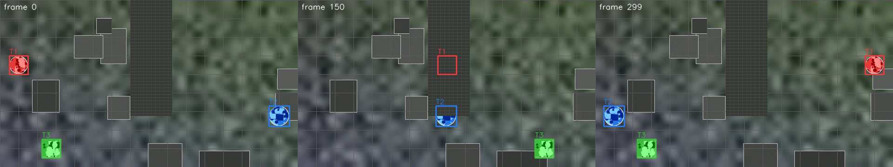
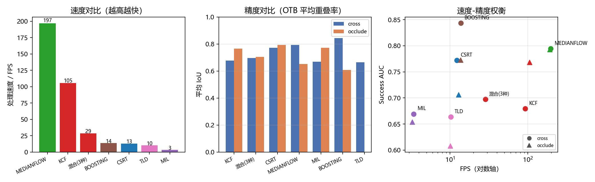
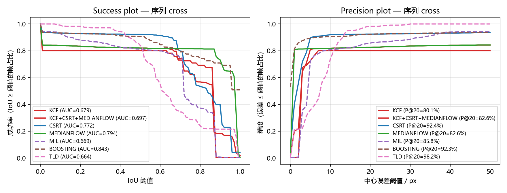
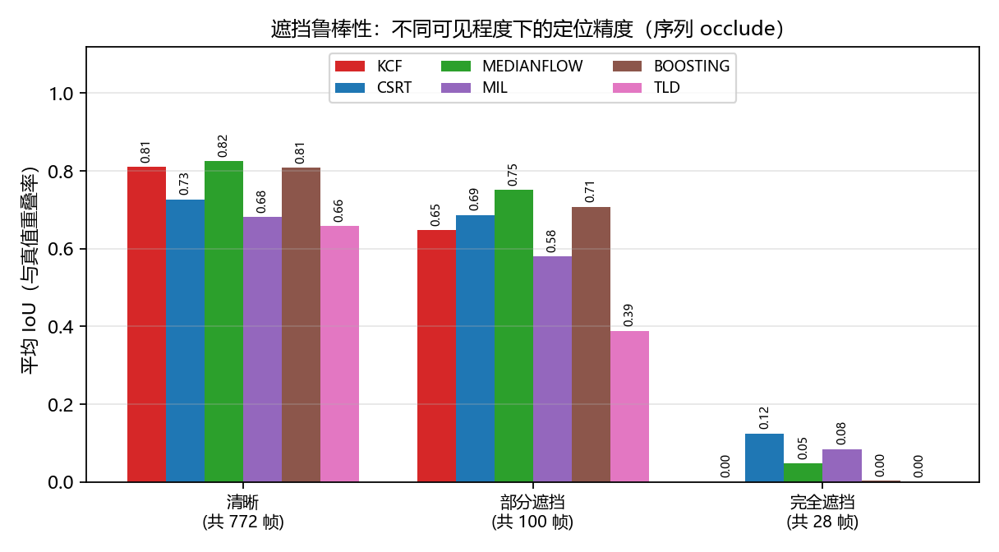
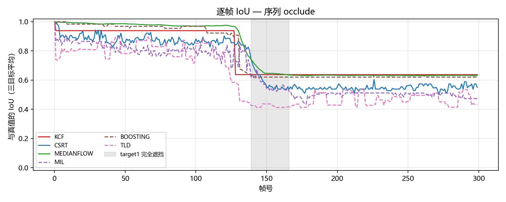
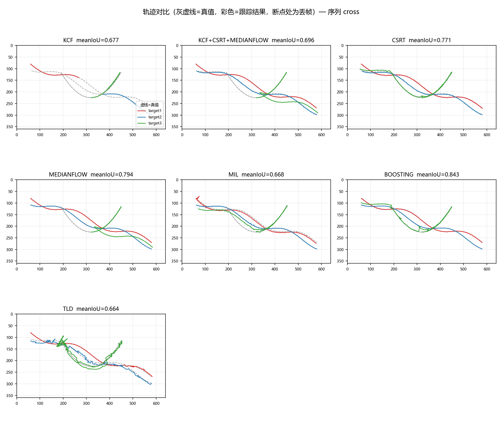
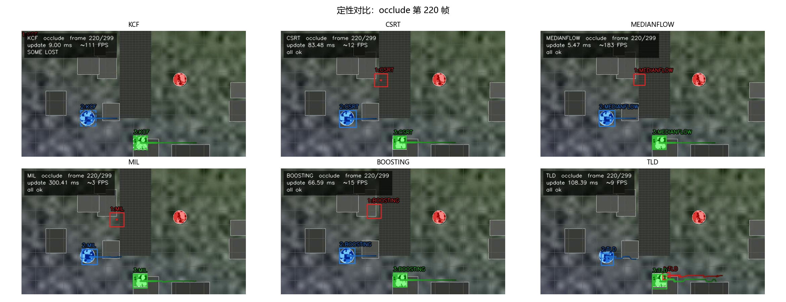

> 个人信息字段已移除。

- 日期：2026 年 10 月
- 模块编号：02
- 类型：算法对比 + 工程实现
- 运行环境：本机

---

# 02 · 多目标跟踪：OpenCV 跟踪器基准

## 1. 任务定义

基于 OpenCV 内置的目标跟踪算法，对一段视频中的多个目标同时进行跟踪，在画面上框出各目标的运动轨迹，并比较不同算法的跟踪效率。具体要求为：

（1）全部使用 OpenCV 自带的跟踪器，不引入深度学习模型；

（2）至少使用三种算法，对同一段视频的多个目标并行跟踪（MultiTracker）；

（3）输入一段视频，逐帧框出目标并绘制其运动轨迹；

（4）使用两种以上的评价指标（OTB、MOTChallenge、VOT）评价跟踪算法的性能、准确率与鲁棒性；

（5）对比不同算法在速度、准确率、遮挡鲁棒性上的优缺点，并给出选型建议。

## 2. 目标

（1）掌握 OpenCV 目标跟踪接口的两套命名空间（cv2.legacy 与 4.x 的新接口）以及它们在本机上的可用性差异；

（2）理解单目标跟踪器的输入输出约定：init(首帧, 初始框) → update(当前帧) → (是否成功, 新框)；

（3）掌握 MultiTracker 的组织方式，能对同一帧的多个目标并行跟踪并把结果绘制成轨迹；

（4）掌握 OTB、MOTChallenge、VOT 三套评价体系的口径差异，能用 Success Plot（AUC）、Precision、MOTA、MOTP、IDSW 等指标量化跟踪质量，而不只看“看起来跟住了没有”；

（5）学会用分档可见比例（清晰 / 部分遮挡 / 完全遮挡）量化遮挡鲁棒性；

（6）学会在遇到“算法在本版本实现不可用”时用对照实验定位问题，而不是改参数硬凑结果。

## 3. 原理

### 3.1  目标跟踪的问题定义与短时跟踪器的定位

跟踪给定第 1 帧的目标框 b₁，要求在后续每一帧输出该目标的新框 b_t。本模块使用的都是“短时跟踪器”（short-term tracker）：只有外观模型、没有检测器，也不做重检测（re-detection）。这决定了它们的共同局限——一旦目标被判为丢失，后续帧不会再找回；多目标场景下某个目标丢失，不影响其它目标的跟踪。

短时跟踪器的通用流程是：在上一帧位置周围取搜索窗 → 对候选窗打分（相关滤波响应、或光流前后向一致性）→ 取响应峰值作为新位置 → 用新位置更新模型。KCF/CSRT/MOSSE 走相关滤波路线，MedianFlow 走光流路线，MIL/Boosting/TLD 走在线学习（分类器）路线。

### 3.2  KCF：核相关滤波

KCF 把跟踪建模成岭回归：在目标周围用循环移位生成大量负样本，训练一个判别函数 f(x) = wᵀx + b，其中 w 由闭式解 w = (XᵀX + λI)⁻¹ Xᵀy 给出。由于训练样本是基样本 x 的循环移位，X 是循环矩阵，可被离散傅里叶变换对角化，于是求逆变成逐元素相除，复杂度从 O(n³) 降到 O(n log n)。

引入核函数后，解只依赖核矩阵 K 的第一行 k^xx，即 f(z) = k̂^xz ⊙ â，其中 â = ŷ / (k̂^xx + λ)。对高斯核做相关时又有 k^xx 可由 x 自身与自身相关的 FFT 得到，因此单帧只有几次 FFT，这也解释了本模块中 KCF 的速度能到 90 FPS 以上。OpenCV 的实现还接了 HOG 多通道特征（把通道求和写进相关运算），精度比原始灰度版本更高。

KCF 的响应峰值位置给出平移，尺度则靠单独的一维尺度滤波器维护（OpenCV 4.x 的 KCF 默认不更新尺度，尺度固定为首帧大小），这直接导致它在目标由远及近时有系统性偏差——本模块中序列 cross 的 target3 尺度逐渐放大，KCF 在该目标上的平均 IoU 明显偏低，正是这一机制的结果。

### 3.3  CSRT：通道与空间可靠性

CSRT 在相关滤波框架上加了两项加权：一是空间可靠性（spatial reliability），给搜索窗内每个像素一个高斯形的权重，越靠近中心权重越大，抑制边界处的背景干扰；二是通道可靠性（channel reliability），用每个特征通道在上一帧响应中的表现动态调整 HOG 与颜色名（Color Names）两类特征的通道权重。尺度方面 CSRT 用一组尺度候选做金字塔搜索，因此能跟上目标的尺度变化。代价是每帧要做多尺度、多通道的相关运算，本模块实测单帧 77~82 ms，只能到 12~13 FPS。

### 3.4  MedianFlow：前后向光流误差

MedianFlow 在目标框内等距采样若干点，用 Lucas-Kanade 稀疏光流把点从上一帧跟踪到当前帧（正向），再把当前帧的点跟踪回上一帧（反向），前后向误差（FB error）大的点判为不可靠。在剩下的可靠点中，用中值位移作为整体平移量，并取各点位移的上下分位数得到新的宽高。若可靠点比例过低或位移的中位数与分位数严重不一致，就报告“跟踪失败”。

这种设计的两个缺点在本模块里都暴露了：一是尺度只由可靠点的分布估计，目标尺度平滑变化时框会逐步收缩或膨胀；二是它对纹理有强依赖——本模块的自检脚本里，若把目标换成纯色块，MedianFlow 甚至无法完成初始化。反过来它极快（5 ms/帧，约 190 FPS），且自带“失败检测”，在需要可靠性的工程里是很实用的低成本方案。

### 3.5  MIL、Boosting、TLD：在线学习路线

Boosting 用在线 AdaBoost 在目标周围选正负样本训练若干弱分类器，取置信图峰值作为位置；MIL 用多示例学习代替单个样本标签，正包由若干可能包含目标的候选框组成，因此对框内混入背景更宽容；TLD 把跟踪（MedianFlow）、学习（P-N 专家在线更新）与检测（级联分类器的滑窗重检测）组合在一起，理论上具备“丢失后再找回”的能力。三者单帧耗时明显高于相关滤波，本模块中 MIL 需要 290 ms/帧，TLD 约 98 ms/帧，Boosting 约 73 ms/帧。

### 3.6  MultiTracker 的组织方式

cv2.legacy.MultiTracker_create() 返回一个容器，add(tracker, frame, bbox) 把“某个跟踪器实例”与首帧的目标框绑定，update(frame) 返回 (ok, boxes)，其中 boxes 的顺序与 add 的顺序一致。本质上它只是一个 for 循环的封装：每个目标各自独立维护自己的搜索窗与模型，帧与帧之间没有数据关联（data association），也没有 ID 管理、遮挡推断或轨迹平滑。因此：

（1）它不会做“哪个框对应哪个目标”的匹配，交叉之后仍靠各自的模型硬跟；

（2）update 返回的 ok 是所有目标的“与”运算，单个目标失败会把整帧标记为失败，这也是本模块另外实现了一个逐目标独立后端（backend=single）的原因；

（3）它没有重检测能力，目标一旦丢失，框会被置零（实测 (0,0,0,0)）而不再更新。

### 3.7  评价指标

OTB 体系。对每一帧计算预测框与真值框的交并比 IoU = |A∩B| / |A∪B|。改变重叠阈值 t ∈ [0,1]，统计 IoU ≥ t 的帧所占比例，得到 Success Plot，其曲线下面积 AUC 作为总体精度指标；同时用中心点误差的分布得到 Precision Plot，取阈值 20 px 处的比例 P@20。另设失败阈值 IoU < 0.1 判定该帧失败，统计失败帧数、失败事件数与最长连续失败帧数。

MOTChallenge 体系。对每一帧用匈牙利算法按 IoU 做真值与预测的一一匹配（阈值 0.5），得到 TP/FP/FN，以及 ID 切换（IDSW）、轨迹碎片化（Frag）、被成功跟踪超过 80% 的目标数（MT）与低于 20% 的目标数（ML）：

MOTA = 1 − (FN + FP + IDSW) / GT，MOTP = 匹配上的框的平均 IoU（以百分比误差形式也常用）。本模块目标数固定为 3 且预测框数恒为 3，因此每次漏配同时产生一个 FN 和一个 FP，两者数值相等。

VOT 体系。本模块采用其轻量口径：accuracy 为平均重叠率，robustness 为跟踪失败事件数（VOT 的完整协议允许在失败后重初始化，本模块不做重初始化，只用失败次数衡量稳定性）。

效率指标。单帧耗时只统计 tracker.update() 的时间（不含读帧、绘制、写盘），并给出均值、95 分位（P95）与等效 FPS = 1000 / 平均耗时；初始化耗时单独统计，因为它在 MultiTracker 里随目标数与算法差异很大（本模块 0.6 ms ~ 864 ms）。

## 4. 实现过程

### 4.1  实验环境

系统的默认 Python 是 3.14，而 C:\anaconda3 里的 OpenCV 是 5.0.0 的基础版：它既没有 cv2.legacy 命名空间，也就没有 cv2.legacy.MultiTracker_create 与多数经典跟踪器。因此本模块用 Python 3.11.9 单独建了一个 venv，安装带 contrib 模块的 4.8.1 版本。

*表 3-1  实验环境*

| 项目 | 配置 |
| --- | --- |
| 操作系统 | Windows 10（10.0.26100）AMD64 |
| CPU | Intel64 Family 6 Model 186，20 个逻辑核 |
| Python | 3.11.9（独立 venv：envs/pcd02_tracking） |
| OpenCV | opencv-contrib-python 4.8.1.78（含 cv2.legacy） |
| 数值/绘图 | numpy 1.26.4、matplotlib 3.8.4 |
| 视频编解码 | OpenCV 自带 mp4v（写）/ FFmpeg 后端（读） |

环境构建命令（在仓库根目录执行）：

```
python ^
    -m venv --without-pip --copies envs\pcd02_tracking
envs\pcd02_tracking\Scripts\python.exe -m ensurepip --upgrade
envs\pcd02_tracking\Scripts\python.exe -m pip install --no-cache-dir ^
    opencv-contrib-python==4.8.1.78 numpy==1.26.4 matplotlib==3.8.4
```

之所以锁 4.8.1 而不是最新的 5.x：4.5.2 之后 OpenCV 把跟踪器移到了 cv2.legacy，而 5.0.0 的基础包不再提供这些经典跟踪器；选 4.8.1 是为了同时拿到 cv2.legacy 完整接口与较新的 FFmpeg。

### 4.2  数据集：自建合成多目标序列

任务要求“输入一段视频”，但没有指定素材。本模块的考核点是算法对比，需要逐帧真值才能算指标，因此用脚本生成两段 640×360、25 fps、300 帧（12 s）的合成多目标视频，并同时输出三种格式的真值。合成的好处是真值精确、遮挡时长可控；代价是纹理比真实场景简单，结论需要向真实场景外推时谨慎。

目标不是纯色块，而是带内部高对比纹理的 sprite（圆/方 + 条纹 + 亮暗斑点），因为自检发现纯色块会让 MedianFlow 无法初始化、CSRT 的尺度会崩到 7×7——那样比较的就是“算法对无纹理目标的退化行为”，不是算法本身。背景是低频噪声 + 静态灰块 + 40 px 网格，提供足够的干扰纹理。

*表 3-2  两段合成序列*

| 序列 | 内容 | 考察点 |
| --- | --- | --- |
| cross | 3 个目标：左上→右下、右下→左上（中段交叉）、绕中心小圆运动并逐渐放大 | 交叉遮挡、尺度变化、多目标同屏 |
| occlude | 静态遮挡条（280,0,90,250）。target1 从条后穿过，完全不可见 28 帧；target2 只露下半部，约 50% 可见 100 帧；target3 不受影响 | 遮挡鲁棒性：清晰 / 部分遮挡 / 完全遮挡三档 |



*图 3-1  序列 occlude 的第 0/150/299 帧（按目标着色的实线框为真值；第 150 帧 target1 完全在遮挡条之后）*

真值同时写三份：annotations/<seq>/otb/<target>.txt（每行 x,y,w,h，OTB 口径）、gt.txt（frame,id,x,y,w,h,conf,class,visibility，MOTChallenge 口径）、first_boxes.json（首帧初始框）。visibility 列由遮挡掩膜精确统计可见像素比例得到，是后面做遮挡分档的依据。

### 4.3  代码结构

代码全部在 experiments/02_ObjectTracking_OpenCV/code/ 下，共 10 个脚本约 2270 行，按“数据 → 跟踪 → 评价 → 出图 → 报告”分层，任一环节可单独重跑：

*表 3-3  代码结构*

| 文件 | 行数 | 职责 |
| --- | --- | --- |
| common.py | 338 | 路径常量、视频/真值读写、IoU 与中心误差、匈牙利匹配、轨迹 CSV 存取 |
| trackers.py | 89 | 7 种跟踪器的名字、构造函数、cv2.legacy 兼容查找与可用性检查 |
| make_synthetic_video.py | 293 | 生成两段合成序列与三种格式真值、首帧预览图 |
| single_target_demo.py | 166 | 单目标 demo：selectROI 框选（或真值首帧框）→ 逐帧跟踪 → 计时 |
| run_multitracker.py | 289 | 多目标：MultiTracker 后端与逐目标独立后端，写视频、轨迹 CSV 与运行时 JSON |
| evaluate.py | 298 | OTB / MOTChallenge / VOT 三套指标 + 可见比例分档，输出 summary.csv |
| make_figures.py | 471 | 曲线、IoU 时间线、轨迹图、速度-精度图、遮挡柱状图、定性拼图与表格 |
| viz.py | 89 | 画框、虚线丢失框、轨迹尾迹、左上角信息面板 |
| run_all.py | 100 | 一键跑完全流程（自检 → 造视频 → demo → 多目标 → 评价 → 出图） |
| tools/check_trackers.py | 138 | 跟踪器可用性自检（合成 patch + 真实序列两段对照） |

### 4.4  实验设计

算法：主对比用 KCF、CSRT、MedianFlow 三种（相关滤波 ×2、光流 ×1），补充基线用 MIL、Boosting、TLD （在线学习 ×3），共 6 种；另做一次“同一个 MultiTracker 里三个目标各用不同算法”的混用实验。每个算法在两段序列上各跑一次，共 13 次运行（含混用）。

计时口径：每次运行先做一次 init+update 预热，再开始正式计时；否则首次调用会因 OpenCV 内部初始化把 init 拉到 1.4 s（本模块第一轮就踩到了这个坑，实测 1482 ms 对预热后的 79 ms）。只统计 update()，读帧与绘制不计入。

参数：初始框全部取首帧真值框（不手动画，保证 6 种算法与 3 个目标的输入完全一致）；所有跟踪器使用 OpenCV 默认参数，不针对某一段序列调参（否则就不是算法对比而是调参比赛）；失败判定 IoU < 0.1，匹配阈值 IoU ≥ 0.5。

### 4.5  跟踪速度实测

表 3-4 是同一段视频、同样 3 个目标、同样 300 帧下的实测速度（括号内为 P95 单帧耗时）。MedianFlow 与 KCF 达到实时，CSRT / Boosting / TLD 只能到 10~14 FPS，MIL 只有 3.3 FPS。

*表 3-4  三种目标同时跟踪时的速度实测（300 帧 × 3 目标）*

| 算法 | cross 均值 ms | P95 | cross FPS | occlude 均值 ms | occlude FPS | init ms |
| --- | --- | --- | --- | --- | --- | --- |
| MEDIANFLOW | 5.08 | (5.95) | 196.7 | 5.22 | 191.7 | 0.66 |
| KCF | 10.81 | (13.29) | 92.5 | 9.49 | 105.3 | 89.89 |
| CSRT | 81.57 | (87.74) | 12.3 | 77.08 | 13.0 | 64.33 |
| BOOSTING | 72.60 | (76.88) | 13.8 | 73.04 | 13.7 | 831.79 |
| TLD | 97.46 | (113.73) | 10.3 | 98.81 | 10.1 | 66.46 |
| MIL | 290.95 | (324.09) | 3.4 | 304.92 | 3.3 | 117.69 |
| 混用三种 | 35.08 | (38.39) | 28.5 | — | — | 40.51 |

几个可以直接读出来的结论：MedianFlow 的耗时几乎与目标数无关（5 ms/帧），因为它只在框内采几十个点做Lucas-Kanade；KCF 的单帧耗时随目标数线性增长（3 个目标 10.8 ms，单目标 demo 里是 3.5 ms），因为每个目标各做一次 HOG + FFT；CSRT 的耗时是瓶颈（3 个目标 82 ms，单目标 26 ms），主要花在多尺度搜索与颜色名通道上；Boosting 的初始化最贵（832 ms），因为它要在首帧训练在线分类器。

### 4.6  运行命令与自检

先跑自检，确认本机的跟踪器可用性；再一键复现全部实验。

```
cd experiments\02_ObjectTracking_OpenCV\code
..\..\..\envs\pcd02_tracking\Scripts\python.exe tools\check_trackers.py
..\..\..\envs\pcd02_tracking\Scripts\python.exe run_all.py        # 约 8 分钟
..\..\..\envs\pcd02_tracking\Scripts\python.exe run_all.py --fast  # 只跑主算法
```

自检脚本对每种算法跑两段测试：一段是脚本自带的高对比 patch（40 帧），一段是真实序列 cross 的前 60 帧、target1 真值框。两段对照能把“调用错误”与“算法在本版本失效”区分开：

*表 3-5  跟踪器可用性自检*

| 算法 | 自带 patch update 成功 | 均值 ms | 真实序列 update 成功 | 均值 ms |
| --- | --- | --- | --- | --- |
| KCF | 39/39 | 2.86 | 59/59 | 3.49 |
| CSRT | 39/39 | 24.34 | 59/59 | 26.73 |
| MEDIANFLOW | 39/39 | 1.15 | 59/59 | 1.52 |
| MIL | 39/39 | 102.48 | 59/59 | 87.71 |
| BOOSTING | 39/39 | 21.24 | 59/59 | 23.40 |
| TLD | 39/39 | 15.31 | 59/59 | 24.68 |
| MOSSE | 39/39 | 0.12 | 0/59 → 框被置零 | 0.06 |

这张表是本次实验最关键的一张“异常证据”：MOSSE 在干净 patch 上 39/39 正常、耗时仅 0.12 ms，但换成真实序列的目标后 59 帧全部失败，且返回的框是 (0,0,0,0)。详见 5.8 节。

## 5. 结果与分析

### 5.1  OTB 与 MOTChallenge 指标汇总

表 3-6 是 OTB 口径：AUC 为 Success Plot 曲线下面积，mean IoU 为逐帧平均重叠率，OP@0.5 / OP@0.75 为 IoU 超过 0.5 / 0.75 的帧比例；表 3-7 是 MOTChallenge 口径。

*表 3-6  OTB 精度指标（3 个目标平均）*

| 序列 | 算法 | AUC | mean IoU | OP@0.5 | OP@0.75 | P@20 | 中心误差 px |
| --- | --- | --- | --- | --- | --- | --- | --- |
| cross | BOOSTING | 0.843 | 0.843 | 90.6% | 77.6% | 92.3% | 11.7 |
| cross | MEDIANFLOW | 0.794 | 0.793 | 82.0% | 81.6% | 82.6% | 39.4 |
| cross | CSRT | 0.772 | 0.771 | 92.2% | 63.1% | 92.4% | 13.1 |
| cross | KCF | 0.679 | 0.677 | 80.1% | 72.6% | 80.1% | 64.3 |
| cross | MIL | 0.669 | 0.668 | 81.2% | 41.1% | 85.8% | 15.5 |
| cross | TLD | 0.664 | 0.664 | 84.0% | 28.6% | 98.2% | 7.2 |
| cross | 混用 | 0.697 | 0.696 | 82.0% | 62.4% | 82.6% | 41.0 |
| occlude | BOOSTING | 0.773 | 0.772 | 81.2% | 81.2% | 81.2% | 34.2 |
| occlude | MEDIANFLOW | 0.793 | 0.792 | 81.7% | 81.3% | 82.3% | 30.4 |
| occlude | CSRT | 0.706 | 0.704 | 82.3% | 81.0% | 82.7% | 30.8 |
| occlude | KCF | 0.768 | 0.767 | 80.9% | 80.9% | 80.9% | 89.3 |
| occlude | MIL | 0.654 | 0.652 | 81.1% | 53.4% | 82.3% | 35.0 |
| occlude | TLD | 0.608 | 0.608 | 72.9% | 44.2% | 81.2% | 58.2 |

*表 3-7  MOTChallenge 指标（匹配阈值 IoU ≥ 0.5）*

| 序列 | 算法 | MOTA | MOTP | IDSW | Frag | FN/FP | MT | ML |
| --- | --- | --- | --- | --- | --- | --- | --- | --- |
| cross | BOOSTING | 0.811 | 0.920 | 0 | 2 | 85/85 | 2 | 0 |
| cross | MEDIANFLOW | 0.640 | 0.961 | 0 | 0 | 162/162 | 2 | 0 |
| cross | CSRT | 0.850 | 0.832 | 3 | 0 | 66/66 | 2 | 0 |
| cross | KCF | 0.602 | 0.846 | 0 | 0 | 179/179 | 2 | 0 |
| cross | MIL | 0.624 | 0.784 | 0 | 1 | 169/169 | 2 | 0 |
| cross | TLD | 0.680 | 0.717 | 0 | 20 | 144/144 | 2 | 0 |
| cross | 混用 | 0.639 | 0.843 | 1 | 2 | 162/162 | 2 | 0 |
| occlude | BOOSTING | 0.675 | 0.949 | 0 | 0 | 142/142 | 2 | 0 |
| occlude | MEDIANFLOW | 0.684 | 0.966 | 0 | 0 | 138/138 | 2 | 0 |
| occlude | CSRT | 0.693 | 0.852 | 0 | 0 | 134/134 | 2 | 0 |
| occlude | KCF | 0.668 | 0.948 | 0 | 0 | 145/145 | 2 | 0 |
| occlude | MIL | 0.672 | 0.795 | 0 | 4 | 143/143 | 2 | 0 |
| occlude | TLD | 0.503 | 0.778 | 0 | 10 | 217/217 | 1 | 0 |

序列 cross（无遮挡，考察交叉与尺度变化）：MOTA 最高的是 CSRT（0.850），其次是 Boosting（0.811）；KCF 只有 0.602，主要失分在 target3 的尺度变化上（该目标 mean IoU 仅 0.29）。MedianFlow 的 MOTP 最高（0.961），说明它“跟住的时候框得很准”，但一旦目标尺度变化就跟丢，MOTA 反而只有 0.640。

序列 occlude（考察遮挡）：MOTA 普遍下降到 0.50~0.69。CSRT（0.693）与 MedianFlow（0.684）最高，TLD 最低（0.503）。值得注意的是 TLD 的 Frag 达到 10 次——它的重检测器在遮挡后确实把目标“找回来”过，但找回的位置常常不准，形成频繁的断续轨迹。

### 5.2  速度与精度的权衡



*图 3-2  速度、精度与二者的权衡（圆点=cross，三角=occlude）*

图 3-2 的右图把 6 种算法放在“FPS–AUC”平面上，可以分成三个层次：MedianFlow 在右上角（190~200 FPS、AUC 0.793~0.794），是性价比最高的一档；KCF 在 90~105 FPS、AUC 0.679~0.768，速度约为 MedianFlow 的一半，精度却更低，原因是它不更新尺度；CSRT 与 Boosting 落在 12~14 FPS，AUC 最高（0.77~0.84），按“精度优先”选；MIL 与 TLD 落在 3~10 FPS 且 AUC 不占优，没有使用价值。

这条结论与教科书的常见说法（KCF 快、CSRT 准）方向一致，但幅度上有个反直觉的点：本模块里 MedianFlow 比 KCF 快 2 倍且更准。原因是 KCF 每帧要对每个目标做多通道 HOG + FFT，而 MedianFlow 只在 40×40 的框里采几十个点；合成序列的运动平滑（每帧 2~4 px），正落在 MedianFlow 的舒适区，而它的尺度估计问题需要长时间累积才显形。

### 5.3  OTB 曲线



*图 3-3  序列 cross 的 Success Plot（左）与 Precision Plot（右）*

Success Plot 里 Boosting 与 MedianFlow 的曲线在中段交叉：阈值低于 0.6 时 MedianFlow 更高，阈值高于 0.6 后 Boosting 反超——说明 MedianFlow 在“大体跟住”的帧更多，而 Boosting 的框更贴合。这与表 3-6 里 MedianFlow 的 OP@0.75（0.816）高于 Boosting（0.776）、但 AUC 反而低 0.05（0.794 对 0.843）的现象一致。Precision Plot 里 TLD 的 P@20 最高（98.2%），但它的 OP@0.5 只有 84.0%——TLD 的框会收缩，中心点很准但重叠率不够，这正说明“只看一个指标会得出相反结论”。

### 5.4  遮挡鲁棒性

把 occlude 序列按真值的可见像素比例分成三档：清晰（≥90%）、部分遮挡（5%~90%）、完全遮挡（<5%），分别统计平均 IoU，得到表 3-8 与图 3-4。

*表 3-8  按可见比例分档的平均 IoU（序列 occlude）*

| 算法 | 清晰帧数 | 清晰 IoU | 部分遮挡帧数 | 部分遮挡 IoU | 完全遮挡帧数 | 完全遮挡 IoU |
| --- | --- | --- | --- | --- | --- | --- |
| MEDIANFLOW | 772 | 0.824 | 100 | 0.751 | 28 | 0.047 |
| CSRT | 772 | 0.727 | 100 | 0.686 | 28 | 0.124 |
| BOOSTING | 772 | 0.808 | 100 | 0.707 | 28 | 0.003 |
| KCF | 772 | 0.810 | 100 | 0.648 | 28 | 0.000 |
| MIL | 772 | 0.682 | 100 | 0.580 | 28 | 0.084 |
| TLD | 772 | 0.658 | 100 | 0.389 | 28 | 0.000 |



*图 3-4  三档可见性下的平均 IoU（序列 occlude）*

可以看到非常清晰的规律：

（1）清晰帧上，MedianFlow（0.824）与 KCF（0.810）、Boosting（0.808）都在 0.8 以上，CSRT 0.727、MIL 0.682、TLD 0.658；

（2）部分遮挡（约 50% 可见）时，MedianFlow 只掉到 0.751（保持率 91%），CSRT 反而更稳（0.686，保持率 94%），而 TLD 直接掉到 0.389（保持率 59%）——TLD 的重检测器在部分遮挡时会把背景块当成目标；

（3）完全遮挡的 28 帧里所有算法都接近 0（0.000~0.124），说明短时跟踪器在“看不见”时无能为力，CSRT 的 0.124 也不是“跟住了”，而是它的框没有立刻被置零，滞留在原处；

（4）遮挡结束后没有任何算法自动恢复：Target1 在 300 帧里的后 170 帧全部为失败，因为 MultiTracker 不做重检测。

图 3-5 的逐帧 IoU 曲线把这一过程画得更直白：第 120 帧左右所有曲线同时坠落，之后再也没有回到 0.9 以上。



*图 3-5  序列 occlude 的逐帧平均 IoU（灰底为 target1 完全遮挡区间）*

### 5.5  多目标场景下“谁更吃亏”：交叉与尺度

序列 cross 里三个目标的成绩差距极大，而且方向在各算法间一致：target1 的平均 IoU 在 0.720~0.983，target2 在 0.604~0.999，而 target3 只有 0.294~0.616。原因不是 target3 纹理差，而是它有两个不利条件叠加：（a）尺度从 20 px 半宽增长到 30 px，凡是不估尺度的算法（KCF 固定尺度、MedianFlow 靠点分布）都会掉分；（b）它与另两个目标的轨迹在中心区交汇两次，交汇时搜索窗里混入另一个目标的外观。

target3 上 KCF 只有 0.294，是全部组合里最差的一项；MedianFlow 0.458、MIL 0.412、Boosting 0.552、TLD 0.553，CSRT 最高（0.616）——它做了尺度金字塔搜索。另一个方向的现象是 CSRT 在 target2 上只有 0.767，是三目标里最低的一档：交叉发生时 CSRT 的搜索窗被另一个目标占满，通道可靠性加权把“新出现的目标”当成了更可信的外观。



*图 3-6  序列 cross 的运动轨迹（灰虚线=真值，彩色=跟踪结果，断点处为丢帧）*

轨迹图上能直接看出丢帧的位置：KCF 与 MedianFlow 的 target3 曲线中途断掉，CSRT 与 Boosting 的曲线基本贴住真值。

### 5.6  定性结果



*图 3-7  序列 occlude 第 220 帧各算法的跟踪结果（虚线框表示该目标被判定丢失）*

第 220 帧处在遮挡结束之后：target1 已经重新出现在画面右侧，但没有一个算法把框重新贴上去——它们的框要么停留在遮挡条上（KCF、MedianFlow），要么在附近漂移（TLD）。而 target3 自始至终没有被遮挡，所有算法都跟得住。这张图是“短时跟踪器无重检测能力”的直观证据。

### 5.7  与任务要求的对应关系

（1）“至少三种算法对多目标进行跟踪”：本模块用 6 种，且额外做了一次三个目标各用不同算法的混用实验；

（2）“框出多目标运动轨迹”：每帧绘制目标框与淡出的轨迹尾迹，同时把轨迹点写入 CSV 并画出轨迹对比图（图 3-6）；

（3）“比较跟踪效率”：表 3-4 给出均值、P95 与 FPS，图 3-2 给出速度-精度平面；

（4）“用两种评价指标评价性能、准确率和鲁棒性”：OTB（AUC/OP/P@20）、MOTChallenge（MOTA/MOTP/IDSW/Frag/MT/ML）、VOT 轻量口径（accuracy/robustness）三套都已实现，并额外用可见比例分档量化遮挡鲁棒性（表 3-8）。

### 5.8  问题与解决

问题一：MOSSE 在本版本上不可用。现象是 init 返回 True，但之后每一帧 update 都返回 False，且返回框为 (0,0,0,0)；轨迹 CSV 里该目标的坐标因此恒为零。定位过程：① 换 BGR/灰度/float32 输入，全部失败；② 尺寸扫描 24~96 px，结果不稳定（32 失败、36 成功、40 失败、44 成功）；③ 换成脚本自带的高对比 patch，MOSSE 39/39 全部成功（表 3-5）——说明不是 API 调用错误，而是与图像内容相关；④ 检查安装，venv 里只有 opencv-contrib-python 4.8.1.78 一个 OpenCV 包，排除了网上常见的“同时装了 opencv-python 与 contrib 版导致崩溃”这一原因；⑤ 查 API，cv2.legacy.TrackerMOSSE 只暴露 create/init/update 等，没有 set()，无法调低 PSR 判据的门限。结论：MOSSE 用峰值旁瓣比（PSR）判断跟踪是否可信，在纹理丰富、干扰多的目标上 PSR 长期低于阈值，而 OpenCV 的实现在判失败时把框清零、不保留上一帧位置，于是“一次判失败、永久为 0”。处理：正式对比不使用 MOSSE（任务里 “KCF、MOSSE、CSRT” 是举例，6 种已满足“至少三种”），并把它的失败过程作为实验结论的一部分记录，而不是删掉了事。

问题二：MultiTracker 的 ok 是“全员成功”。它把所有目标的成败做逻辑与，单个目标丢失就会让整帧显示失败，无法直接评估“逐目标的成功率”。解决：在 run_multitracker.py 里额外实现 SingleBackend——为每个目标各建一个跟踪器实例，逐目标拿 ok 与框；两种后端写出的轨迹 CSV 格式一致，评价脚本无需区分。

问题三：首次调用的初始化耗时有假象。第一轮实测 KCF 的 init 是 1482 ms，而冷启动消除后只有 79 ms。解决：正式计时前先做一次 init+update 预热，并在报告里只引用预热后的数值。

问题四：中文在 Windows 控制台输出乱码、matplotlib 中文变方框。解决：脚本统一调用 setup_console() 把标准输出改为 utf-8；绘图前按顺序探测 Microsoft YaHei / SimHei / Noto Sans CJK 并设置 rcParams['font.sans-serif']。

问题五：pip list 在 Git Bash 下会卡住不返回（本环境的已知问题）。解决：改用 importlib.metadata 读版本，并把依赖版本写进 requirements.txt 固定。

### 5.9  本模块结论

（1）精度。无遮挡的多目标场景下，CSRT 的 MOTA 最高（0.850），Boosting 次之（0.811），两者 AUC 也最高（0.772 / 0.843）；KCF 因不更新尺度，AUC 只有 0.679。

（2）速度。MedianFlow 约 190~200 FPS，KCF 约 92~105 FPS，两者可实时；CSRT 与 Boosting 约 12~14 FPS；TLD 约 10 FPS；MIL 只有 3.3 FPS，不可用于实时。

（3）遮挡鲁棒性。部分遮挡（约 50% 可见）时 CSRT 保持率最高（94%）、MedianFlow 次之（91%）；完全遮挡时全部失效（IoU ≈ 0），且遮挡结束后无一恢复——这是“短时跟踪器无重检测”的必然结果，工程上必须外接检测器或重检测模块。

（4）选型建议。实时性优先（>30 FPS）选 MedianFlow 或 KCF；需要抗尺度变化与遮挡选 CSRT；若必须在遮挡后继续跟踪，应在 MultiTracker 之外加上周期性检测（如每 30 帧跑一次检测器）并做数据关联，而不能指望 OpenCV 的跟踪器自己找回目标。

（5）方法层面的结论。同一段输入下不同算法可以差出 20 倍的速度与 0.25 的 AUC，而这种差异必须用“速度 + OTB + MOT + 分档鲁棒性”这一组指标才能说清：单看 OP@0.5 会认为 TLD 与 Boosting 差不多，加上 OP@0.75 与 Frag 才能看出 TLD 的框在收缩、轨迹在断续。

## 8. 交付物清单

代码：experiments/02_ObjectTracking_OpenCV/code/（10 个脚本，含 tools/check_trackers.py 自检）

依赖：experiments/02_ObjectTracking_OpenCV/requirements.txt，环境说明见该目录 README.md

视频：datasets/tracking_videos/videos/cross.mp4、occlude.mp4

真值：datasets/tracking_videos/annotations/{cross,occlude}/{otb/*.txt, gt.txt, first_boxes.json}

结果视频：outputs/videos/（13 个，其中 mt_* 为多目标、single_* 为单目标 demo）

轨迹 CSV：outputs/traces/；指标：outputs/metrics/summary.csv 与 eval_*.json

图表：outputs/figures/ 与 outputs/tables/；同步副本在 reports/figures/02_*.png、reports/tables/02_*.csv
