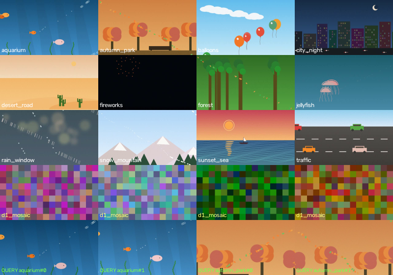
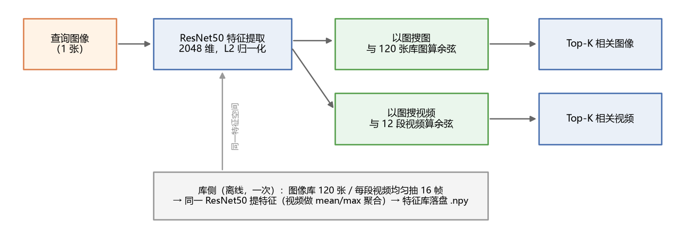
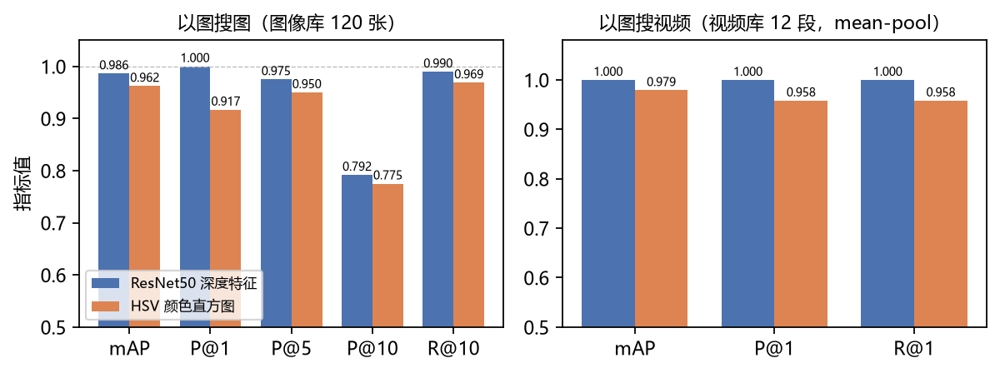
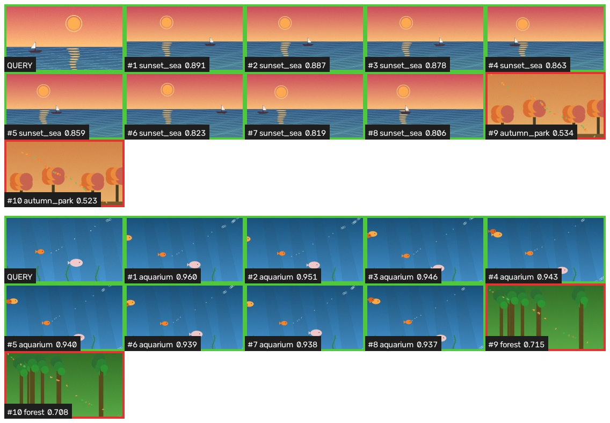
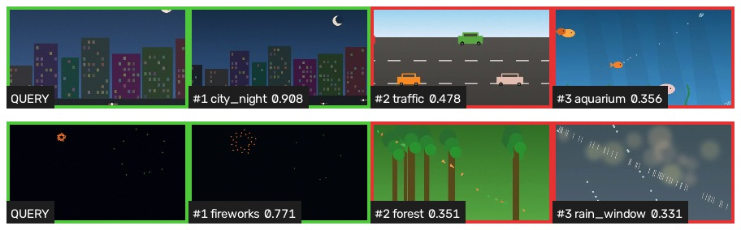
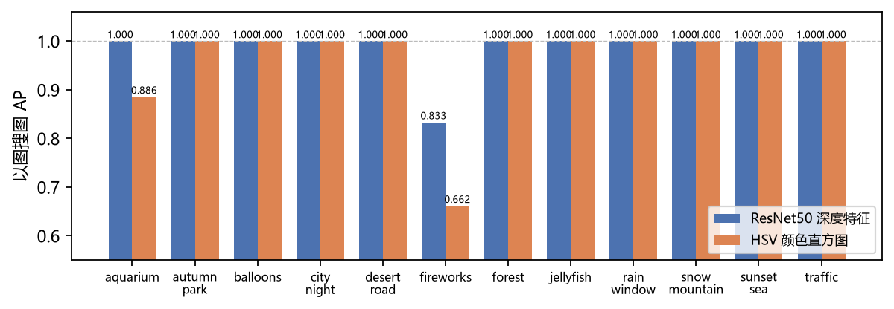
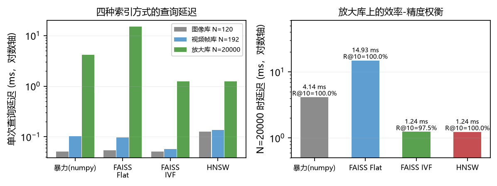

# 04 · 视频检索：以图搜图 / 以图搜视频

## 1. 任务定义

基于深度学习方法，综合利用视频检索方法，实现以图搜图与以图搜视频，并比较搜索的效率。具体要求为：借鉴深度学习模型框架，实现输入一张图片，可以检出相关的图像和视频；使用两种不同的评价指标来评价搜索算法的性能与准确率。

本模块采用 Python + PyTorch 方案实现（不使用上游规格文档中需要编译 VLFEAT 与 YAEL 的斯坦福 C++ 代码），并构造了一个可控的本地小型检索测试库：12 段合成短视频、120 张图像（含 96 张视频抽帧与 24 张纯图像干扰样本）以及 24 张查询图，覆盖 12 个视频场景与 6 个图像干扰场景。以图搜图在 120 张图像库上检索，以图搜视频在 12 段视频库上检索；评价指标采用 Precision@K 与 mAP 两种；检索效率从建库耗时、单次查询延迟、QPS 与内存占用四个角度，对暴力检索与 FAISS Flat、FAISS IVF、HNSW 三种工程索引进行对比。

## 2. 目标

（1）理解基于内容的图像/视频检索（CBIR/CBVR）的问题定义：以图搜图与以图搜视频都可以归结为「把查询与库内容映射到同一特征空间，再按相似度排序」的向量最近邻问题；

（2）掌握用 ImageNet 预训练 CNN（ResNet50）作特征提取器的方法：去掉分类层、取全局平均池化特征、L2 归一化后以余弦相似度检索，理解预训练模型「迁移」到检索任务的方式；

（3）掌握视频的深度表示方法：均匀抽帧 → 逐帧特征 → 池化聚合（mean / max / frame-max 三种），理解「图像与视频特征必须来自同一特征空间」这一前提；

（4）掌握两种检索评价指标：Precision@K（返回的前 K 个结果里有多少相关）与 mAP（把相关项排得越靠前得分越高的综合排序质量），并能解释两类任务下指标上限的差异；

（5）掌握暴力检索与三种工程索引（FAISS Flat / IVF 倒排、HNSW 图索引）的原理与适用场景，用建库耗时、查询延迟、QPS、内存与召回率衡量搜索效率，理解效率-精度权衡；

（6）学会用程序化方式构造带真值的检索测试库：场景即类别，相关性真值由目录名自动推导，既免去人工标注，也从构造上排除了「自己搜自己」。

## 3. 原理

### 3.1  基于内容的图像/视频检索问题定义

给定一张查询图像 q、一个图像库 D_img = {x(1), ..., x(N)} 与一个视频库 D_vid = {v(1), ..., v(M)}，检索的目标是把库中条目按与 q 的相似度降序排列，使相关条目尽量排在前面。以图搜图的相关条目是「与 q 同一语义类别的图像」，以图搜视频的相关条目是「包含 q 所拍内容的视频」。二者的核心都是：先抽特征，再算相似度，最后排序。

上游规格文档采用的是斯坦福 videosearch 方案：提取关键帧 → 镜头边界检测 → SIFT 局部特征 → Fisher Vector 全局编码 → Bloom Filter 索引，用平均精准度（AP）与精准率（P@1）评价。该方案需要在 Linux/macOS 下编译 VLFEAT 与 YAEL 两个 C++ 库，Windows 环境搭建困难。本模块用深度学习方案替代其中的「局部特征 + 编码」环节：直接用预训练 CNN 的全局特征作为描述子，检索退化为向量空间里的最近邻问题，流程更短且不需要任何训练。

### 3.2  深度特征提取：ResNet50 全局特征

ResNet50 是带残差连接的 50 层卷积网络：输入经 conv1 + MaxPool 降到 1/4 分辨率，再经过 4 个 bottleneck stage（通道 256/512/1024/2048）逐级下采样，最后做全局平均池化（avgpool）得到 2048 维向量、接 1000 类全连接分类层。检索中把分类层去掉（fc → Identity），avgpool 输出的 2048 维向量就是整张图的「全局描述子」：它对平移鲁棒（池化），保留了纹理、形状与颜色布局等中层语义信息。

网络权重直接使用 torchvision 提供的 ImageNet-1k 预训练版本（IMAGENET1K_V2），不做任何微调——这是检索任务里常见的「预训练模型即取即用」做法。图像预处理与训练时一致：缩放到短边 232、中心裁剪 224×224、按 ImageNet 均值方差归一化。特征做 L2 归一化后，两向量的内积即余弦相似度，尺度效应被消除。

| 项目 | 配置 |
| --- | --- |
| 骨干网络 | torchvision.models.resnet50，权重 ResNet50_Weights.IMAGENET1K_V2（ImageNet-1k） |
| 截断位置 | fc 层替换为 Identity，取 avgpool 输出 |
| 特征维度 | 2048 维，float32，L2 归一化 |
| 预处理 | Resize(232) → CenterCrop(224) → 归一化（mean/std = ImageNet 统计） |
| 传统基线 | HSV 颜色直方图（H/S/V = 8×4×4 = 128 维），仅作对照 |

*表 1  深度特征提取配置*

### 3.3  视频表示：抽帧与聚合

图像模型不能直接吃视频，标准做法是「抽帧 + 聚合」：对每段视频均匀抽取 N 帧，逐帧提特征得到 {x(1), ..., x(N)}，再聚合成一个视频级向量或一组帧级候选。本模块对比三种聚合方式：

（a）平均池化（mean-pool）：v = (1/N)·Σ x(i)。保留视频整体外观，对查询只与视频一小段相似的情况会被背景稀释；

（b）最大池化（max-pool）：v = max(x(1), ..., x(N))（逐维取最大）。突出最显著的帧，但对离群帧敏感；

（c）帧级检索（frame-max）：不聚合，查询与每一帧算相似度，视频得分取其各帧最大值，即 score(v) = max_i cos(q, x(i))。保留帧级分辨率，召回最稳，但候选数从 M 变成 M×N。

三种方式的候选特征都来自同一个 ResNet50 特征空间，与查询图像直接可比——这是「以图搜视频」能成立的前提。

### 3.4  相似度度量与四种索引结构

相似度用余弦相似度 cos(q, x) = q·x / (||q||·||x||)。所有特征 L2 归一化后，余弦相似度等价于内积，检索就是「查与查询向量内积最大的 K 个库向量」。四种检索方式如下：

| 方式 | 原理 | 查询复杂度 | 特点 |
| --- | --- | --- | --- |
| brute（numpy） | 查询与全库做矩阵乘，argpartition 取 Top-K | O(N·D) | 零依赖、小库最快，BLAS 多线程 |
| FAISS Flat | IndexFlatIP：C++/SIMD 实现的精确内积暴力检索 | O(N·D) | 结果与暴力一致，批量查询有优势 |
| FAISS IVF | IndexIVFFlat：k-means 把库分成 nlist 个桶，查询只扫最近的 nprobe 个桶 | O((N/nlist)·nprobe·D) | 近似检索，nlist≈4√N，牺牲少量召回换速度 |
| HNSW | hnswlib：分层可导航小世界图，从顶层稀疏图逐层贪心下降 | ≈O(log N) | 高召回低延迟，建库慢、内存放大 1.5~1.6 倍 |

*表 2  四种检索方式对比*

### 3.5  评价指标：Precision@K 与 mAP

| 指标 | 定义 | 说明 |
| --- | --- | --- |
| Precision@K | P@K = \|Top-K 中相关项\| / K | 前 K 个结果里有多少是对的，反映「找得准」 |
| Recall@K | R@K = \|Top-K 中相关项\| / \|相关项总数\| | 该找的里面有多少被找回，反映「找得全」 |
| AP / mAP | AP = Σ(P@i × rel(i)) / \|相关项总数\|；mAP = 各查询 AP 的均值 | 相关项排得越靠前 AP 越高，综合排序质量 |

*表 3  两种评价指标的定义*

两类任务的相关项数量不同：以图搜图里每个查询有 8 个相关项（同场景的 8 张库图）；以图搜视频里每个查询只有 1 个相关项（源视频）。因此以图搜视频的 P@K 数学上限是 1/K（K≥2），评价以 P@1（等价于命中率）与 mAP 为主；以图搜图则可看完整的 P@1/5/10 与R@10。这两种指标与上游规格要求的「平均精准度和精准度」一致。

### 3.6  合成测试库与真值约定

公开的检索测试集（如斯坦福测试库）要么体积大、要么需要境外下载，且本模块的核心是方法对比而非刷榜，因此用 OpenCV 程化生成一个可控的小型库：12 个视觉场景（海边日落、城市夜景、森林、雪山、水族馆、沙漠、烟花、车流、气球、雨窗、水母、秋日公园）各生成 1 段 8 s、640×360@24fps 的短视频；每段视频向图像库贡献 8 帧；另造 6 个纯图像干扰场景（马赛克、平滑噪声、渐变艺术、几何拼贴、条纹波纹、模糊色块）各 4 张。查询图取自视频场景的「库外帧」，并做随机裁剪（78%~92%）、亮度/对比度扰动（±12%）与随机水平翻转，从构造上排除了「自己搜自己」。场景 id 即类别：以图搜图的相关项 = 同场景全部库图，以图搜视频的相关项 = 源视频，真值由目录名/文件名自动推导，无需人工标注。

## 4. 实现过程

### 4.1  实验环境

| 项目 | 配置 |
| --- | --- |
| 操作系统 | Windows 11（build 26300） |
| CPU / GPU | Intel Core i7-13700H / NVIDIA GeForce RTX 4060 Laptop（8 GB，CUDA 13.2） |
| Python | 3.14.6（系统环境 C:\Python314） |
| 深度学习框架 | PyTorch 2.14.0+cu130、torchvision 0.29.1+cu130（GPU 版） |
| 图像 / 视频处理 | OpenCV 5.0.0.93（含 FFmpeg，可直接读写 mp4） |
| 向量检索 | faiss-cpu 1.15.1、hnswlib |
| 数值 / 可视化 | numpy 2.5.1、matplotlib 3.11 |

*表 4  实验环境*

与视频摘要实验（03）复用 conda 环境不同，本次实验时系统 Python 3.14 下已装好 CUDA 13.0 版的 PyTorch 2.14，直接 pip 补装 OpenCV 与 faiss/hnswlib 即可，实测 torch.cuda.is_available() = True，特征提取全程在 GPU 上完成。

### 4.2  数据集构建

数据集由 code/make_dataset.py 一次性合成，规模如下：

| 部分 | 内容 | 数量 | 说明 |
| --- | --- | --- | --- |
| videos/ | 合成短视频（mp4，8 s，640×360@24fps） | 12 段 / 2304 帧 / 5.6 MB | 12 个场景，场景名即类别 |
| images/ | 视频抽帧（每段 8 帧，JPEG q=92） | 96 张 | 与视频同场景 |
| images/ | 纯图像干扰场景 | 6 场景 × 4 张 = 24 张 | 无对应视频，只入库不作查询 |
| queries/ | 查询图（库外帧 + 裁剪/亮度/翻转增强） | 24 张（每场景 2 张） | 真值 = 来源场景 |

*表 5  本地检索测试库组成（共 120 张库图 + 24 张查询图）*



*图 1  测试库样例：上 12 张为视频场景（第 96 帧），下两排为图像干扰场景与查询图*

12 个场景在颜色与结构上做了刻意的部分重叠（烟花/城市夜景同为暗底、水族馆/水母同为蓝绿色调、沙漠/秋日同为暖色），使检索任务不是单纯的「看颜色猜类别」；干扰场景里的暗色模糊色块（d6_blobs）专门用来吸引「暗帧」查询。

### 4.3  总体流程



*图 2  以图搜图 / 以图搜视频的总体流程*

全部流程分六步，对应 7 个运行脚本（run_step1~7）：合成数据集 → 提特征（深度 + 直方图）→ 建索引（四种）→ 精度评价（P@K 与 mAP）→ 效率测量（三种规模 × 四种索引）→ 检索演示→ 生成报告插图。特征提取一次完成后落盘（outputs/features/*.npy），后续步骤只加载特征文件，重跑评价与效率实验不需要再过网络。

### 4.4  特征提取实现

深度特征提取的核心代码如下（code/extract_features.py）：

```
class DeepExtractor:
    def __init__(self):
        self.model = torchvision.models.resnet50(
            weights=ResNet50_Weights.IMAGENET1K_V2)
        self.model.fc = torch.nn.Identity()   # 去掉分类层 → avgpool 2048 维
        self.model.eval().to('cuda')
    def batch(self, bgr_list):               # BGR uint8 → (B, 2048)
        with torch.no_grad():
            x = torch.stack([self.tf(img[:, :, ::-1]) for img in bgr_list])
            return self.model(x.to('cuda')).cpu().numpy()
```

对图像库 120 张、查询图 24 张、视频 12 段 × 16 帧共 336 张输入提取特征，在 GPU 上深度特征共耗时 3.08 s（约 9.2 ms/张，含预处理与 CPU↔GPU 拷贝），HSV 直方图 0.38 s（约 1.1 ms/张）；视频抽帧用 cv2.CAP_PROP_POS_FRAMES 定位、在整段 192 帧里均匀取 16 帧（每 12 帧一帧）。所有特征 L2 归一化后存为 .npy。

| 特征 | 维度 | 提取设备 | 336 张总耗时 | 单张均耗时 |
| --- | --- | --- | --- | --- |
| ResNet50 avgpool（深度） | 2048 | GPU（RTX 4060） | 3.08 s | 9.2 ms |
| HSV 直方图（基线） | 128 | CPU | 0.38 s | 1.1 ms |

*表 6  特征提取耗时对比*

### 4.5  检索与索引实现

四种索引实现为统一的「build / search(q, k)」接口（code/utils.py），查询统一走 cosine_scores → 排序。IVF 的桶数按 FAISS 经验法则自适应：nlist ≈ 4·√N 且不超过 N/39（FAISS 要求每簇至少 39 个训练点），nprobe = nlist/16；例如 N=120 时 nlist=3、nprobe=1，N=20000 时 nlist=512、nprobe=32。建索引时用「库里第一张图必须检到自己」做自检。检索演示入口为 code/search.py：输入一张查询图，同时输出以图搜图 Top-K 与以图搜视频 Top-K 的拼图（绿框命中、红框错误）与排序列表 JSON。

### 4.6  评价与效率测量方法

精度评价：24 张查询图 × 2 种特征（深度 / 直方图）× 2 类任务；以图搜图对 120 张库图全排序算 P@1/3/5/10、R@5/10 与 mAP；以图搜视频按三种聚合方式对 12 段视频排序算 P@1、P@3 与 mAP（另有直方图特征作对照）。

效率测量：在三个规模上测四种索引——真实图像库 N=120、视频帧库 N=192、放大库 N=20000（把 120 个真实特征重采样 2 万份并叠加 σ=0.02 的高斯噪声再归一化，保持真实特征的各向异性）。每档测建库耗时、单次查询延迟（100 次查询取均值，放大库 20 查询 × 3 轮）、QPS、索引内存，以及相对暴力精确解的 Top-10 召回率（衡量近似索引丢了多少精度）。

## 5. 结果与分析

### 5.1  以图搜图：深度特征优于颜色直方图

| 特征 | mAP | P@1 | P@3 | P@5 | P@10 | R@5 | R@10 |
| --- | --- | --- | --- | --- | --- | --- | --- |
| ResNet50 深度特征 | 0.9861 | 1.0000 | 0.9861 | 0.9750 | 0.7917 | 0.6094 | 0.9896 |
| HSV 颜色直方图 | 0.9623 | 0.9167 | 0.9444 | 0.9500 | 0.7750 | 0.5938 | 0.9688 |

*表 7  以图搜图检索精度（120 张库图，24 张查询图）*



*图 3  两种特征在两个任务上的指标对比*

深度特征在所有指标上全面占优：P@1 达到 1.0（24 个查询的第一名全部正确），mAP 0.9861 对 0.9623。差距虽然只有约 0.024，但失败模式不同：直方图有两个查询的第一名就排错（aquarium_q1 排进了同为蓝绿色调的水母场景，fireworks_q1 排进了暗色干扰图），而深度特征 24 个查询的 P@1 全对，错误只发生在排序中后段（把个别同场景暗帧排在了其他场景的亮帧之后）。R@10 二者都接近 0.99，说明 Top-10 里基本能把同场景 8 张图收齐。



*图 4  以图搜图演示（上：sunset_sea_q0 与 aquarium_q1；下：city_night_q1 与 fireworks_q0，绿框=同场景命中，红框=干扰）*

四个查询的 Top-8 几乎全为同场景命中，只有 fireworks_q0 的第 9、10 位混入了 d4_shapes 与 forest——烟花场景里「爆发帧」与「暗帧」的外观差异极大（相似度从 0.93 掉到 0.74），暗帧被暗色干扰图追上是符合直觉的失败方式。

### 5.2  以图搜视频：三种聚合方式的对比

| 特征 | 聚合方式 | mAP | P@1（命中率） | P@3 |
| --- | --- | --- | --- | --- |
| ResNet50 深度特征 | mean-pool | 1.0000 | 1.0000 | 0.3333 |
| ResNet50 深度特征 | max-pool | 1.0000 | 1.0000 | 0.3333 |
| ResNet50 深度特征 | frame-max | 1.0000 | 1.0000 | 0.3333 |
| HSV 颜色直方图 | mean-pool | 0.9792 | 0.9583 | 0.3333 |

*表 8  以图搜视频检索精度（12 段视频库，24 张查询图；单相关项，P@3 上限为 1/3）*



*图 5  以图搜视频演示（上：sunset_sea_q0 与 aquarium_q1；下：city_night_q1 与 fireworks_q0；缩略图为命中视频里与查询最相似的抽帧）*

深度特征下三种聚合方式全部拿到 mAP = 1.0、命中率 100%：24 个查询无一例外把源视频排在第一，且第一名相似度（0.77~0.91）与第二名（0.33~0.62）之间有明显间隔。三种方式等价的原因是本库的场景内差异远小于场景间差异：每段视频只有一个镜头、16 帧均匀抽样已覆盖全场景，mean/max/frame-max 自然殊途同归。可以预期在多镜头长视频上三者会拉开差距——此时 mean-pool 会被无关镜头稀释，frame-max 更稳，这也是上游规格推荐的 APIVR 类方法（先筛掉冗余背景片段再检索）要解决的问题。直方图基线在 fireworks_q1 上失败（命中率 95.8%），与以图搜图的失败模式一致。

### 5.3  每场景分析：烟花是最难的场景



*图 6  以图搜图逐场景 AP（12 个视频场景）*

10 个场景上两种特征都是满分，差异集中在两处：fireworks（深度 0.833 / 直方图 0.662）与 aquarium（深度 1.000 / 直方图 0.886）。fireworks 难在「两态分布」：爆发帧有大面积彩色粒子，暗帧几乎全黑，同一场景内部的特征方差被拉大，暗帧查询容易被暗色干扰图（d6_blobs）和城市夜景吸走；aquarium 难在与水母场景同色系（深蓝绿），颜色直方图几乎无法区分二者，而深度特征能利用鱼/水母的形状与纹理差异。这正体现了「语义鸿沟」：低层颜色特征与高层语义之间隔着一层，深度特征把它填上了大半。

### 5.4  检索效率：暴力、Flat、IVF 与 HNSW

| 规模 | 方式 | 建库耗时 | 查询延迟 | QPS | 内存 | R@10 |
| --- | --- | --- | --- | --- | --- | --- |
| N=120 | brute | 1.2 ms | 0.051 ms | 19 669 | 0.94 MB | 100% |
| （图像库） | FAISS Flat | 198.1 ms | 0.054 ms | 18 514 | 0.94 MB | 100% |
|  | FAISS IVF | 18.4 ms | 0.051 ms | 19 617 | 0.94 MB | 94.6% |
|  | HNSW | 11.9 ms | 0.126 ms | 7 956 | 1.50 MB | 100% |
| N=192 | brute | 1.8 ms | 0.103 ms | 9 679 | 1.50 MB | 100% |
| （视频帧库） | FAISS Flat | 2.4 ms | 0.098 ms | 10 239 | 1.50 MB | 100% |
|  | FAISS IVF | 11.5 ms | 0.057 ms | 17 454 | 1.50 MB | 100% |
|  | HNSW | 9.6 ms | 0.135 ms | 7 397 | 2.40 MB | 100% |
| N=20000 | brute | 139.8 ms | 4.144 ms | 241 | 156.2 MB | 100% |
| （放大库） | FAISS Flat | 249.7 ms | 14.929 ms | 67 | 156.2 MB | 100% |
|  | FAISS IVF | 1 741.4 ms | 1.241 ms | 806 | 156.2 MB | 97.5% |
|  | HNSW | 2 299.4 ms | 1.236 ms | 809 | 250.5 MB | 100% |

*表 9  三种规模下四种检索方式的效率对比（延迟为 100 次查询均值）*



*图 7  查询延迟（对数轴）与放大库上的效率-精度权衡*

四个观察：

（1）小库（N≤192）上所有方式的延迟都在 0.14 ms 以内，暴力检索（numpy）反而最快——数据量小时建索引纯属开销，直接矩阵乘最好；本库 120 张图 × 2048 维只有 0.94 MB，一次矩阵乘就扫完了。

（2）规模放大到 2 万后差距拉开：IVF 与 HNSW 的延迟都是 1.24 ms，比 numpy 暴力的 4.14 ms 快 3.3 倍、QPS 高 3.3 倍；HNSW 召回无损（100%），IVF 用 nprobe=32/512 的配置损失 2.5%（97.5%）——这就是「近似索引用少量精度换速度」的直接体现。延迟随规模的增长也符合各自复杂度：brute 增长约 81 倍（0.05→4.14 ms），HNSW 只有 9.8 倍（0.13→1.24 ms）。

（3）FAISS Flat 反而比 numpy 暴力慢（14.9 ms 对 4.1 ms）。原因是本机 numpy 走 BLAS 多线程矩阵乘，而 faiss 1.15 默认单线程处理单条查询；这说明「工程库一定更快」并不成立，参数与线程配置同样是效率的一部分。

（4）HNSW 的代价在库外：建库 2.3 s（IVF 1.7 s、暴力仅 0.14 s），内存 250 MB（其他 156 MB，放大约 1.6 倍）。它用离线建库与内存换在线低延迟，适合「建一次、查亿万次」的在线服务；离线一次性任务则不必付这个代价。

### 5.5  端到端的效率视角与选型建议

把特征提取和检索连起来看：GPU 上深度特征约 9.2 ms/张，而本库任何索引的检索延迟都不超过 0.14 ms——特征提取是端到端延迟的绝对大头（约 65 倍）。因此在十万级以下的库上，优化检索结构的收益远小于优化特征（换更轻的骨干如 MobileNet、批量提特征、特征降维）。只有当库规模继续放大（本模块 2 万向量时暴力 4.1 ms、百万级时预计 200 ms 以上），索引的选择才开始主导延迟。综合本模块：小库离线用 numpy 暴力即可；中等规模要求精确结果用 FAISS Flat；大规模且允许约 2% 召回损失用 IVF；在线低延迟、高召回用 HNSW。

### 5.6  本模块结论

· 用「预训练 ResNet50 全局特征 + 余弦相似度」完整实现了以图搜图（mAP 0.9861、P@1 1.0）与以图搜视频（mAP 1.0、命中率 100%），并复现了上游规格要求的两种评价指标（精准率与平均精准度）的完整计算流程；

· 深度特征全面优于 HSV 颜色直方图（mAP +0.024 / +0.021，P@1 +0.083 / +0.042），且失败方式更「温和」：直方图会因同色系（水族馆/水母）与明暗分布（烟花暗帧）整体排错，深度特征只在排序中后段出现个别混淆；

· 三种视频聚合方式在单镜头短视频上等价（mAP 均 1.0），说明聚合方式的选择取决于「场景内差异与场景间差异的相对大小」，长视频多镜头场景应优先 frame-max 或先做镜头/冗余片段过滤；

· 效率上，小库（百级）暴力最快、建索引无意义；2 万向量时 IVF/HNSW 把延迟从 4.1 ms 压到 1.2 ms（3.3 倍），HNSW 无召回损失但建库慢、内存多 60%；FAISS Flat 在单线程配置下可能慢于 numpy 暴力，工程库的默认参数不一定最优；

· 端到端视角下特征提取（9.2 ms/张）比检索（≤0.14 ms）慢两个数量级，小规模检索系统的优化重点在特征侧而非索引侧。

## 6. 问题与处理

| 问题 | 现象 | 解决办法 |
| --- | --- | --- |
| 上游规格方案环境不可用 | 斯坦福 videosearch 需编译 VLFEAT/YAEL（C++），Windows 下搭建困难且代码较老 | 改用 Python + PyTorch：预训练 CNN 全局特征替代 SIFT + Fisher Vector |
| OpenCV 写视频失败 | sunset_sea 场景写出的 mp4 为 0 字节，FFmpeg 报 Failed to write frame | 逐帧检查发现场景函数拼出了 558 行的帧（海面渐变高度参数漏传），修正后 12 段视频全部可读、帧数校验通过 |
| 查询图场景标签错误 | 评价时 mAP 异常，查询场景全被解析成 queries | 场景标签原来取父目录名；查询图是平铺存放的，改为从文件名解析（xxx_q0.jpg → xxx） |
| 指标出现 mAP/R@K > 1 | 相关项集合被写成 {场景名}（1 个元素），而实际相关项有 8 张 | 把「相关项」统一改成库内条目下标的集合，AP/P/R 的分母都取集合大小，指标回到 [0,1] |
| FAISS IVF 训练点不足 | WARNING clustering 120 points to 8 centroids: please provide at least 312 | nlist 改为按 N 自适应：nlist = min(4√N, N/39)，小库自动缩到 3~4 桶 |
| faiss_flat 慢于 numpy | N=20000 时 Flat 14.9 ms、numpy 暴力 4.1 ms | 确认是 faiss 默认单线程而 numpy BLAS 多线程所致；作为「配置影响效率」的案例写入分析 |

*表 10  实验中遇到的问题与解决办法*

## 7. 交付物清单

| 文件 | 说明 |
| --- | --- |
| experiments/04_VideoRetrieval/code/config.py | 路径与参数配置 |
| code/make_dataset.py | 合成测试库（12 视频 + 120 库图 + 24 查询图） |
| code/extract_features.py | ResNet50 深度特征 + HSV 直方图基线，落盘 .npy |
| code/utils.py | 相似度、P@K/mAP 计算、四种索引实现 |
| code/build_index.py | 建四种索引并自检 |
| code/evaluate.py | 两种评价指标的完整评价（accuracy*.csv） |
| code/benchmark.py | 效率对比（efficiency.csv） |
| code/search.py | 检索演示：输入一张图，输出相关图像与视频拼图 |
| code/make_figures.py | 生成报告插图（reports/figures/04_*.png） |
| code/build_report_04.py | 生成本报告 |
| run_step1~7.cmd | 七步复现脚本（数据 → 特征 → 索引 → 评价 → 效率 → 演示 → 插图） |
| datasets/retrieval/{videos,images,queries} | 本地检索测试库（约 9.5 MB） |
| outputs/features/ | 特征与元数据（images/queries/videos *_resnet50.npy 等） |
| outputs/metrics/ | accuracy.csv、accuracy_per_query.csv、accuracy_per_scene.csv、efficiency.csv、summary.md |
| outputs/results/<查询图>/ | 每个查询的检索结果拼图与 JSON |
| reports/04_视频检索_技术报告.md | 本报告 |

*表 11  代码与结果文件清单*

复现顺序：run_step1_make_dataset.cmd → run_step2_extract_features.cmd → run_step3_build_index.cmd → run_step4_evaluate.cmd → run_step5_benchmark.cmd → run_step6_search_demo.cmd → run_step7_make_figures.cmd。数据合成与特征提取带有固定随机种子，重跑结果一致；评价与效率实验只依赖特征文件，可反复运行。
